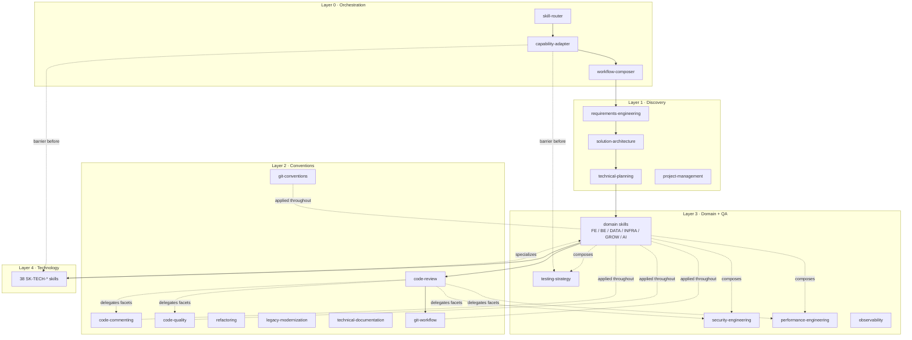

# Dependency Graph

The layered composition DAG for the 69 skills. Edge types per
[README](README.md#relationship-type-vocabulary). This document gives structure;
the [matrices](matrices.md) give the lookup tables.

## Backbone (composition & prerequisite flow)

Layer 0 orchestrates; work flows down the layers, with conventions (Layer 2) and
quality (Layer 3 QA) applied throughout rather than at one point.



## Prerequisite chains (the canonical temporal order)

Prerequisites are the *hard* orderings. The main chain:

```
requirements-engineering ⇐ (task intake)
solution-architecture    ⇐ requirements-engineering
technical-planning       ⇐ solution-architecture
implementation (domain+tech) ⇐ technical-planning
verification (testing)   ⇐ implementation
code-review              ⇐ implementation  (reviews the change)
git-workflow / commit    ⇐ code-review clean
```

Domain-internal prerequisites:

- `orm-integration ⇐ data-modeling` (need a model before mapping it).
- `data-migration ⇐ data-modeling` (need target schema before migrating).
- `database-operations ⇐ data-modeling` (tune against a defined schema).
- `rendering-strategy` and `styling-systems` follow `frontend-architecture`.
- `authentication-authorization ⇐ api-design`/`backend-architecture` (secure a defined surface).
- `deployment-release ⇐ ci-cd-pipeline`; `ci-cd-pipeline` composes `testing-strategy`.
- `refactoring ⇐ testing-strategy` (safety net first) — or an explicit no-net flag.

Cross-cutting skills (`security-engineering`, `performance-engineering`,
`testing-strategy`, `code-commenting`, `code-quality`) have **no single**
prerequisite slot — they attach throughout and are composed by many skills.

## Specialization edges (Layer 4 → Layer 3 parents)

Every technology skill specializes one or more Layer-3 parents (full table in
[skill-catalog.md](../taxonomy/skill-catalog.md#technology-skill-table)).
Representative:

- `react`, `vue`, `angular`, `nextjs`, `nuxt` → `frontend-architecture`, `rendering-strategy`.
- `express`, `fastify` → `backend-architecture`, `api-design`.
- `postgresql`, `mysql` → `data-modeling`, `database-operations` (+ `search-integration` for PG).
- `drizzle`, `prisma`, `typeorm`, `mongoose` → `orm-integration`, `data-migration`.
- `jest-vitest`, `playwright` → `testing-strategy`.
- `docker` → `containerization`; `github-actions` → `ci-cd-pipeline`; `google-seo` → `seo-optimization`.

A technology skill **never** re-implements its parent's method; it supplies
version-correct specifics (spec rule QR-2, no duplication).

## Cross-cutting reference edges (the anti-duplication mechanism)

Three Layer-3 QA skills are the **single owners** of their cross-cutting
knowledge; every other skill *references* them rather than restating:

- `security-engineering` (SK-QA-002) — owned by it; referenced by every
  technology skill, `authentication-authorization`, `code-review`,
  `web-monetization` (consent), `ci-cd-pipeline` (secrets/OIDC).
- `performance-engineering` (SK-QA-003) — referenced by `database-operations`,
  `caching-strategy`, `rendering-strategy`, and technology skills.
- `testing-strategy` (SK-QA-001) — referenced by `refactoring`,
  `ci-cd-pipeline`, `legacy-modernization`, and the tech test-tool skills.

## Review edges (which skills review which)

`code-review` (SK-CONV-007) is the **aggregator**; it delegates *facets* to the
owning skills and collects/ranks their findings — review is a facet delivered by
several skills, not a monolith (taxonomy decision):

| Review facet | Owned by | Reviews |
|---|---|---|
| correctness / general | `code-review` | any change |
| security | `security-engineering` | any change touching a trust boundary/secret/untrusted input |
| performance | `performance-engineering` | any change with a perf budget or hot path |
| code quality | `code-quality` | any authored code |
| comment quality | `code-commenting` | any authored code |
| convention adherence | `git-conventions` | commits/branches |

Review facets are **parallel-safe** (they read the same diff, write no shared
state) — see the [parallelization matrix](matrices.md#parallelization-matrix).

## Fallback edges (capability-driven)

Resolved by `capability-adapter` (SK-ORCH-002) at the barrier:

| Preferred | Fallback | Trigger |
|---|---|---|
| `playwright` (browser, Tier C) | advisory-only, or Playwright-via-MCP on Claude Code | host lacks native browser automation (Claude Code, Windsurf) |
| any Tier-B CLI skill (build/test/migrate) | advisory output + "not executed" note | shell unavailable/denied |
| MCP-db access (structured) | shell `psql`/CLI, or advisory | no DB MCP server; TOML/JSON config mismatch (Codex) |
| container-run (`docker`) | advise shell-wrapped docker CLI; verify availability | no first-class container primitive (all agents) |
| semantic/RAG repo search | agentic grep/read | host has no standing index (Claude Code, Codex) |
| cross-session memory dependency | in-session only + explicit statement | host lacks/removed memory (Windsurf Devin Local) |

These are exactly the non-uniform capabilities the
[agent-capability map](../../research/knowledge-maps/agent-capability-map.md)
flagged; the fallback edges make each degrade gracefully instead of failing.

## Escalation edges (skill → gate)

Summarized here, tabulated in the [escalation matrix](matrices.md#escalation-matrix):

- **To human (approval):** destructive DB migration, git history rewrite /
  force-push, production deploy/release, anything outward-facing (PR post,
  external send), accepting terms/OAuth. (Safety-rule-driven, non-overridable.)
- **To another skill:** `code-review ↑ security-engineering` (security finding);
  `solution-architecture ↑ requirements-engineering` (requirement gap surfaces);
  `refactoring ↑ code-review` (found a bug — hand off, don't silently fix);
  `debugging ↑ bug-fixing` (root cause found); any tech skill `↑` its Layer-3
  parent when the problem is actually engine-agnostic.

## Conflict clusters (mutual exclusion for one decision)

Full pairs in the [conflict matrix](matrices.md#conflict-matrix). The clusters —
pick **one** per decision within a single artifact:

- Frontend framework: `react` ⊥ `vue` ⊥ `angular`.
- Meta-framework: `nextjs` ⊥ `nuxt`.
- Relational engine: `postgresql` ⊥ `mysql` (⊥ `clickhouse` for OLTP role).
- ORM: `drizzle` ⊥ `prisma` ⊥ `typeorm` (SQL); `mongoose` is Mongo-only.
- API paradigm (per endpoint): `api-design` (REST) ⊥ `graphql-api-design`.
- Component library: `mui` ⊥ `shadcn-ui`.

Conflicts are **soft at repo scope** (a monorepo may contain both React and Vue
apps) but **hard at decision scope** (one component is not both). `skill-router`
resolves by detecting which is actually in play for the current artifact.
