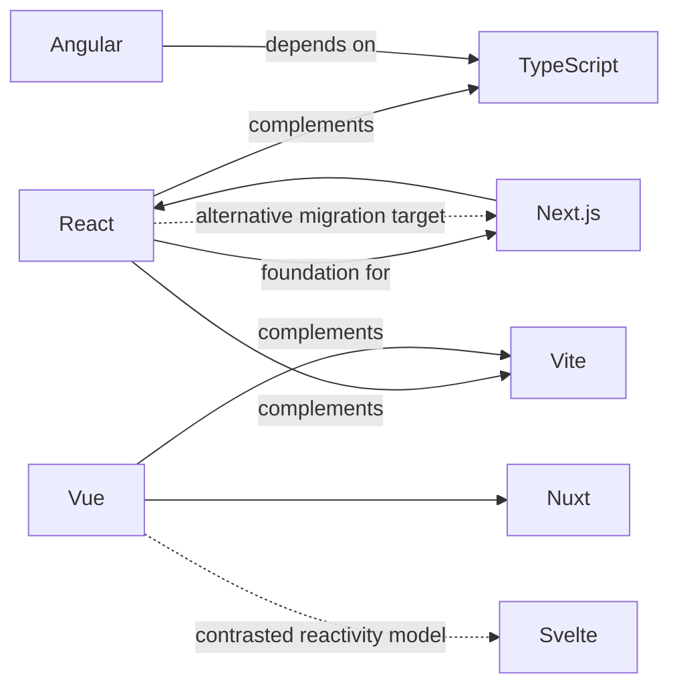
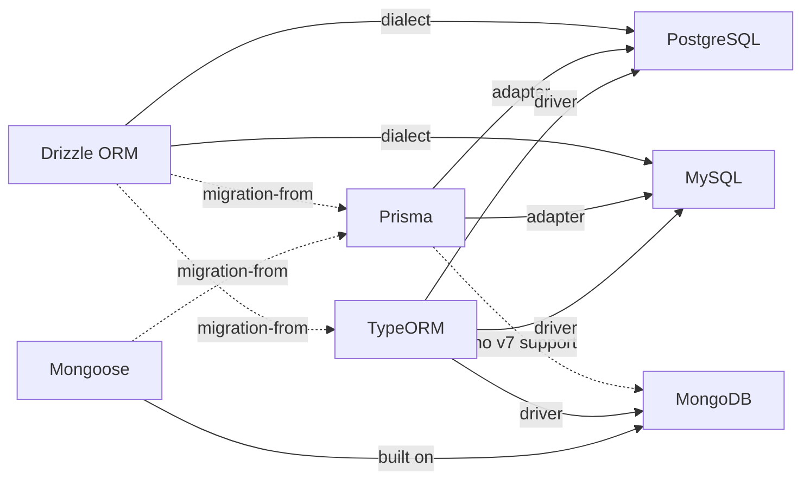

# Technology Knowledge Map

**Scope.** This is the master technology graph for the Skill Library project. It covers all 44 researched technologies, organized by category. For each technology it gives a short node summary (name, category, one-line description drawn from the underlying research's `coreConcepts`) followed by its outgoing relationships — `dependsOn`, `complementaryWith`, `alternativesTo`, `conflictsOrInappropriateWith`, `integratesWith` — each carrying forward the citation from the compiled research data (which itself traces to `research/technologies/<slug>.md` and from there to primary official documentation).

**Sourcing rule.** Every relationship and fact below comes from the compiled JSON data supplied for this task — nothing here was invented. Where the underlying research is silent, thin, or conflicting on a point relevant to this map, that is called out explicitly rather than filled in. Passages introduced by **[Synthesis: ...]** are new cross-cutting inferences this map draws by combining two or more individually-stated facts — they are not claims the underlying research made directly, and are kept visually distinct from sourced material throughout.

**What this is not.** This document maps relationships between technologies for reference. It does not define, design, or write any "skill" (no SKILL.md content, no step-by-step agent instructions) — it exists to inform later skill design.

---

## Contents

1. [How to read a node](#how-to-read-a-node)
2. [Category index](#category-index)
3. [Frontend Frameworks](#frontend-frameworks) — React, Next.js, Vue, Nuxt, Angular
4. [Backend Frameworks / Runtimes](#backend-frameworks--runtimes) — Express, Fastify
5. [Programming Languages](#programming-languages) — Go, Python
6. [Language Specs](#language-specs) — TypeScript, HTML, ECMAScript
7. [SQL Databases](#sql-databases) — PostgreSQL, MySQL
8. [NoSQL / OLAP Databases](#nosql--olap-databases) — MongoDB, ClickHouse
9. [ORMs / ODMs](#orms--odms) — Drizzle ORM, Prisma, TypeORM, Mongoose
10. [Containerization & Cache](#containerization--cache) — Docker, Redis
11. [Realtime Networking](#realtime-networking) — WebRTC, Socket.IO, WebSocket API
12. [Search Engine](#search-engine) — OpenSearch
13. [API Spec & Tooling](#api-spec--tooling) — OpenAPI, Swagger, GraphQL
14. [Styling / UI](#styling--ui) — CSS, Sass, Tailwind CSS
15. [Component Libraries](#component-libraries) — shadcn/ui, MUI (Material UI)
16. [3D Graphics](#3d-graphics) — Three.js
17. [VCS Platform & Git Tooling](#vcs-platform--git-tooling) — GitHub, Husky
18. [Testing Tools](#testing-tools) — Playwright, Jest, Vitest
19. [Build Tool](#build-tool) — Vite
20. [CI/CD](#cicd) — GitHub Actions
21. [Growth / SEO / Ads](#growth--seo--ads) — Google SEO, Google AdSense
22. [Cross-cutting syntheses](#cross-cutting-syntheses)
23. [Coverage gaps in the underlying research](#coverage-gaps-in-the-underlying-research)
24. [Agent-capability profile (context, not part of the technology graph)](#agent-capability-profile)

---

## How to read a node

Each technology gets:

- **Category** and a **one-line description** pulled from that technology's `coreConcepts`.
- **dependsOn** — hard prerequisites; the technology cannot function without these.
- **complementaryWith** — technologies commonly paired with it, without a hard dependency.
- **alternativesTo** — competing technologies occupying the same slot.
- **conflicts / inappropriate with** — documented anti-patterns, incompatibilities, or deprecated combinations.
- **integratesWith** — documented integration points (plugins, drivers, adapters, APIs).

Every bullet ends with its citation exactly as carried from the compiled data. A relationship with no listed items for a given technology means the underlying research recorded none — that is itself informative and is generally left as an empty section rather than papered over.

---

## Category index

| Category | Technologies |
|---|---|
| frontend-framework | React, Next.js, Vue, Nuxt, Angular |
| backend-framework-runtime | Express, Fastify |
| programming-language | Go, Python |
| language-spec | TypeScript, HTML, ECMAScript |
| sql-database | PostgreSQL, MySQL |
| nosql-database / olap-database | MongoDB, ClickHouse |
| orm | Drizzle ORM, Prisma, TypeORM, Mongoose |
| containerization / cache | Docker, Redis |
| realtime-networking | WebRTC, Socket.IO, WebSocket API |
| search-engine | OpenSearch |
| api-spec-tooling | OpenAPI, Swagger, GraphQL |
| styling-ui | CSS, Sass, Tailwind CSS |
| component-library | shadcn/ui, MUI (Material UI) |
| 3d-graphics-library | Three.js |
| vcs-platform / git-hooks-tooling | GitHub, Husky |
| testing-tool | Playwright, Jest, Vitest |
| build-tool | Vite |
| ci-cd | GitHub Actions |
| growth-seo-ads | Google SEO, Google AdSense |

---

## Frontend Frameworks

### React
*Component-based UI library: Components, JSX, Props, State/Hooks, unidirectional data flow, reconciliation.*

- **complementaryWith:** TypeScript — official first-class integration requiring `@types/react`/`@types/react-dom` and a valid `jsx` tsconfig option `[Source: https://react.dev/learn/typescript]`. · Vite — one of three officially recommended build tools; React Compiler pre-wired into `create-vite` scaffolds `[Source: https://react.dev/learn/build-a-react-app-from-scratch]`. · Next.js — the framework taking "full advantage of React's architecture," most complete Server Components + Suspense implementation `[Source: https://react.dev/learn/start-a-new-react-project]`. · Docker — Next.js apps on React deployable to Node.js/Docker hosting `[Source: https://react.dev/learn/start-a-new-react-project]`.
- **conflictsOrInappropriateWith:** Create React App (CRA) — deprecated Feb 14 2025, no longer officially endorsed; a production app still on CRA is an unsupported toolchain `[Source: https://react.dev/blog/2025/02/14/sunsetting-create-react-app]`.
- **integratesWith:** TypeScript (React 19 changed `useRef()` typing, replaced global `JSX` namespace with scoped `React.JSX`) `[Source: https://react.dev/learn/typescript]`. · Vite. · Next.js (also both affected by Dec 2025 RSC CVE-2025-55182, patched Next.js 14.2.35–16.1.5) `[Source: https://react.dev/blog/2025/12/03/critical-security-vulnerability-in-react-server-components]`. · HTML (React 19 native document metadata, Web Components support) `[Source: https://react.dev/blog/2024/12/05/react-19]`. · CSS (native stylesheet precedence support, React 19) `[Source: https://react.dev/blog/2024/12/05/react-19]`. · ESLint (`eslint-plugin-react-hooks`, Compiler-powered rules) `[Source: https://react.dev/blog/2025/10/07/react-compiler-1]`. · Babel (React Compiler ships as a Babel plugin) `[Source: https://react.dev/blog/2025/10/07/react-compiler-1]`. · GitHub (canonical source repos) `[Source: https://github.com/react/react/releases]`.
- **Security:** `dangerouslySetInnerHTML` is the primary documented XSS vector `[Source: https://react.dev/reference/react-dom/components/common]`. CVE-2025-55182 (CVSS 10.0, RSC deserialization RCE) affected 19.0–19.2.0, fixed 19.0.1/19.1.2/19.2.1, with an incomplete-patch follow-up (CVE-2026-23864) requiring 19.0.4/19.1.5/19.2.4 `[Source: https://react.dev/blog/2025/12/11/denial-of-service-and-source-code-exposure-in-react-server-components]`.
- **Performance:** React Compiler (Babel plugin, stable v1.0 Oct 2025) — Meta-internal results: up to 12% faster initial loads, some interactions up to 2.5x faster `[Source: https://react.dev/blog/2025/10/07/react-compiler-1]`.
- **Testing:** `react-test-renderer` and `react-dom/test-utils` are deprecated; official replacement is `@testing-library/react` `[Source: https://react.dev/warnings/react-test-renderer]`.
- **Version:** Current major React 19 (Dec 2024), current minor 19.2 (Oct 2025), npm `latest` 19.2.8 `[Source: https://registry.npmjs.org]`.

### Next.js
*React framework for full-stack apps: App Router (RSC) + Pages Router, file-system routing, Cache Components / PPR.*

- **dependsOn:** React — App Router bundles React canary releases; Pages Router uses the project's own React version `[Source: https://nextjs.org/docs]`. · Node.js — default server runtime, minimum Node.js 20.9+ as of 16.3.4 `[Source: https://nextjs.org/docs/app/api-reference/edge]`.
- **complementaryWith:** TypeScript (5.1.0+, `next typegen`) `[Source: https://nextjs.org/docs/app/guides/production-checklist]`. · Docker (official deployment path, "all Next.js features") `[Source: https://nextjs.org/docs/app/getting-started/deploying]`. · Sass, Tailwind CSS (dedicated official guides) `[Source: https://nextjs.org/docs/app/guides]`.
- **alternativesTo:** Vite — official "Vite → Next.js" migration guide exists `[Source: https://nextjs.org/docs/app/guides/migrating]`.
- **conflictsOrInappropriateWith:** Sass — Turbopack (default bundler since v16) doesn't support the legacy tilde (`~`) import prefix `[Source: https://nextjs.org/docs/app/guides/upgrading/version-16]`. · Docker — for local dev on Mac/Windows, `npm run dev` is recommended over Docker for performance `[Source: https://nextjs.org/docs/app/getting-started/deploying]`.
- **integratesWith:** React. · TypeScript. · Sass, Tailwind CSS. · Docker. · Jest, Vitest, Playwright (official testing guides) `[Source: https://nextjs.org/docs/app/guides/testing]`. · GitHub (Vercel/Bun deployment adapters hosted under Next.js org). · WebSocket API (May 2026 patched SSRF in WebSocket upgrade handling) `[Source: https://vercel.com/changelog/next-js-may-2026-security-release]`. · OpenTelemetry (`instrumentation.ts`) `[Source: https://nextjs.org/docs/app/guides/instrumentation]`.
- **Security:** `server-only`/`client-only` packages enforce a server/client data boundary `[Source: https://nextjs.org/docs/app/guides/data-security]`. May 2026 coordinated security release patched 13 advisories including CVE-2026-23870 (upstream React RSC DoS) and a High-severity SSRF in WebSocket upgrade handling, affecting **all** of Next.js 13–14, requiring upgrade to 15.5.18+/16.2.6+ `[Source: https://vercel.com/changelog/next-js-may-2026-security-release]`.
- **Performance:** Turbopack disk/memory caching cut dev-server RAM up to ~90%, repeat/CI builds up to 5.5x faster (vendor-reported) `[Source: https://nextjs.org/blog/next-16-3]`.
- **Version:** react-server-dom-* 19.0–19.2 patched to 19.0.6/19.1.7/19.2.6 in the May 2026 release `[Source: https://vercel.com/changelog/next-js-may-2026-security-release]`.

### Vue
*Progressive framework: Options/Composition API, SFCs, Proxy-based reactivity via `reactive()`/`ref()`.*

- **dependsOn:** Node.js — SSR requires a Node.js server process `[Source: https://vuejs.org/guide/scaling-up/ssr.html]`. · ECMAScript — Vue 3's `reactive()` requires native ES Proxy support (Vue 2 used `Object.defineProperty()` due to lacking Proxy support) `[Source: https://vuejs.org/guide/extras/reactivity-in-depth.html]`.
- **complementaryWith:** Vite (recommended build tool; `create-vue` scaffolds Vite projects) `[Source: https://vuejs.org/guide/scaling-up/tooling.html]`. · TypeScript (bundled type declarations, `vue-tsc`) `[Source: https://vuejs.org/guide/typescript/overview.html]`. · Nuxt (recommended SSR/SSG meta-framework) `[Source: https://vuejs.org/guide/scaling-up/ssr.html]`. · Vitest ("created and maintained by members of the Vue / Vite team") `[Source: https://vuejs.org/guide/scaling-up/testing.html]`. · Playwright (E2E). · Vue Router (official router). · Pinia (official state management, recommended over Vuex) `[Source: https://vuejs.org/guide/scaling-up/state-management.html]`.
- **alternativesTo:** Svelte — Vue's runtime dependency-tracking reactivity is explicitly contrasted with Svelte's compile-time approach; Vue explored and rejected a compile-time "Reactivity Transform" `[Source: https://vuejs.org/guide/extras/reactivity-in-depth.html]`.
- **integratesWith:** Vue Router, Pinia, Vite, TypeScript, Vitest, Playwright, Nuxt, VitePress. · Sentry, Bugsnag (official error-tracking guides) `[Source: https://vuejs.org/guide/best-practices/production-deployment.html]`. · Laravel (official Vite plugin). · Web Components (bidirectional — `defineCustomElement()`, 100% "Custom Elements Everywhere" score) `[Source: https://vuejs.org/guide/extras/web-components.html]`. · Cypress, Jest (community adapter only, not first-line).
- **Security:** Auto-escapes text interpolation/attribute bindings by default; `v-html` bypasses escaping and is an explicit injection vector; compiling untrusted strings as a template is equated with arbitrary JS execution `[Source: https://vuejs.org/guide/best-practices/security.html]`.
- **Version:** Vue 2 EOL 2023-12-31, no further patches `[Source: https://vuejs.org/guide/introduction.html]`. Vapor Mode is scoped to the 3.6 line; at research time npm `latest` was still 3.5.42 while 3.6.0 sat at rc.7 — **[Synthesis: combining the npm dist-tag with the GitHub rc tag shows Vapor Mode's "stable" status claimed by secondary sources was not yet reflected in the actual release channel as of the research date]**.

### Nuxt
*Vue meta-framework: file-based routing, Universal Rendering by default, Nitro server engine, auto-imports.*

- **dependsOn:** Vue — built directly on top of Vue.js `[Source: https://nuxt.com/docs/4.x/getting-started/introduction]`. · Node.js — 22.x+ minimum for the 4.x line `[Source: https://nuxt.com/docs/4.x/getting-started/installation]`.
- **complementaryWith:** TypeScript (zero-config, auto-generated project-referenced tsconfigs). · Vite (default bundler, configurable to webpack/Rspack). · Tailwind CSS (via `@nuxtjs/tailwindcss` module). · Vitest (required for Nuxt-runtime unit tests). · Playwright, Jest (E2E runners).
- **conflictsOrInappropriateWith:** Docker — `nuxt dev --inspect` node-inspector debugging documented as not working inside Docker `[Source: https://nuxt.com/docs/4.x/guide/going-further/debugging]`.
- **integratesWith:** Vue, TypeScript, Vite, Tailwind CSS, Vitest, Jest, Playwright. · Pinia — "the official Vue recommendation" for state management `[Source: https://nuxt.com/docs/4.x/getting-started/state-management]`. · GitHub (security fixes via GHSA advisories).
- **Security:** Four named GHSA advisories in the v4.5 security disclosure: server-side RCE via `vue.runtimeCompiler` + server-island props (High); DevTools RCE via unauthenticated Vite HMR socket RPC (Critical, dev-only); cross-user cached-payload disclosure on `cache`/`swr`/`isr` routes for authenticated pages (High, 4.4.0+); case-insensitive routing bypassing `routeRules`/`appMiddleware` auth checks (High) `[Source: https://nuxt.com/blog/v4-5-security]`.
- **Version:** Node.js 22.19+ required once bundled `jiti` is removed on 3→4 upgrade `[Source: https://nuxt.com/docs/4.x/getting-started/upgrade]`. Nuxt 3.x EOL 2026-07-31.

### Angular
*Components + Signals + hierarchical Dependency Injection; @-prefixed control flow; Hydration + Event Replay.*

- **dependsOn:** TypeScript — exact version pinned per Angular major (22.0.x requires `>=6.0.0 <6.1.0`) `[Source: https://angular.dev/reference/versions]`. · RxJS — `^6.5.3 || ^7.4.0` across 20.x–22.x. · Node.js — version pinned per major (22.0.x requires `^22.22.3 || ^24.15.0 || ^26.0.0`).
- **complementaryWith:** Vite (modern build pipeline uses Vite + esbuild). · Playwright (real-browser testing alongside default Vitest+jsdom).
- **conflictsOrInappropriateWith:** Hammer.js — removed from `platform-browser` as a formal v22.0.0 breaking change `[Source: raw GitHub CHANGELOG.md, v22.0.0 entry]`. · Zone.js — zoneless change detection (stable/default v21+) is the replacement architecture, mutually exclusive per app `[Source: https://angular.dev/guide/zoneless]`.
- **integratesWith:** RxJS (`@angular/core/rxjs-interop`: `toSignal()`, `toObservable()`, `rxResource()`) `[Source: https://angular.dev/ecosystem/rxjs-interop]`. · GitHub (`ng add angular-cli-ghpages`). · Vitest (default test runner since v21, replacing Karma). · Playwright, WebdriverIO. · Angular Material/CDK. · Gemini CLI, Antigravity — official "Agent Skills" for AI coding agents as of the v22 era `[Source: https://angular.dev/ai/agent-skills]`. · AngularJS (via `ngUpgrade`/`upgrade/static` for hybrid apps).
- **Security:** Auto-sanitizes template bindings by security context; `DomSanitizer.bypassSecurityTrust*` explicitly flagged as introducing vulnerabilities if misused `[Source: https://angular.dev/best-practices/security]`. `HttpClient` includes CSRF/XSRF protection by default via cookie/header interceptor.
- **Version:** v20 dropped TS <5.8 and Node v18; v21 dropped TS <5.9; v22 dropped TS <6.0 and made `OnPush` the change-detection default `[Source: https://angular.dev/reference/versions]`.

---

## Backend Frameworks / Runtimes

### Express
*Fast, unopinionated, minimalist Node.js web framework: middleware pipeline, routing, mountable Router objects.*

- **dependsOn:** Node.js — 5.x requires `>=18`, 4.x requires `>=0.10` `[Source: https://expressjs.com/]`. · Node.js http/https modules — `app.listen()` is shorthand for `http.createServer(app).listen(...)` `[Source: https://expressjs.com/en/starter/hello-world.html]`.
- **complementaryWith:** MongoDB, Mongoose (recommended ODM layer), MySQL, PostgreSQL (via `pg-promise`), Redis (session store for clustered deployments) `[Source: https://expressjs.com/en/guide/database-integration.html, https://expressjs.com/en/advanced/best-practice-performance.html]`. · TypeScript (project setup documented, though Express's own runtime is plain JS). · Socket.IO.
- **alternativesTo:** Fastify, Koa, Hapi — all three named as frameworks Express provides no migration path from `[Source: https://expressjs.com/en/starter/faq.html]`.
- **integratesWith:** MongoDB, Mongoose, MySQL, PostgreSQL, Redis, Elasticsearch (all via official database-integration guide). · TypeScript (`@types/express`/`@types/node`). · Socket.IO. · Node.js `diagnostics_channel` (HTTP lifecycle event subscription without patching Express) `[Source: https://expressjs.com/en/guide/debugging.html]`.
- **Security:** `helmet` recommended for security headers `[Source: https://expressjs.com/en/advanced/best-practice-security.html]`. `res.redirect`/`res.location` had two CVEs: XSS (CVE-2024-43796, fixed 4.20.0) and open-redirect (CVE-2024-29041, fixed 4.19.0/4.19.1). `trust proxy` misconfiguration enables client-IP spoofing via `X-Forwarded-*` `[Source: https://expressjs.com/en/guide/behind-proxies.html]`.
- **Performance:** `NODE_ENV=production` caches views/CSS, ~3x improvement per Express's own benchmarks `[Source: https://expressjs.com/en/advanced/best-practice-performance.html]`.
- **Testing:** No official first-party testing guide exists on expressjs.com; `supertest` is common but not an expressjs.com-cited tool, so it cannot be listed as officially documented under this project's sourcing rules `[Source: research/technologies/express.md Section 9]`.
- **Version:** Express 5.x requires Node.js >=18; 4.x requires >=0.10. `path-to-regexp` upgrade in 5.x introduced new route-path syntax `[Source: https://expressjs.com/en/guide/routing.html]`. npm `latest` 5.2.1, `latest-4` still receiving patches at 4.22.2 as of 2026-05-11 — **[Synthesis: the 4.x line continuing active patch releases roughly 1.5 years after 5.x became default `latest` indicates a long parallel-support tail unusual among the frameworks in this map]**.

### Fastify
*Fastify instance + schema-driven (JSON Schema) validation/serialization + plugin `register()` encapsulation.*

- **dependsOn:** Node.js — v5 requires Node.js v20+ `[Source: https://fastify.dev/docs/latest/Reference/Server/]`. · Ajv v8 (schema compilation) `[Source: https://fastify.dev/docs/latest/Reference/Validation-and-Serialization/]`. · `fast-json-stringify` (serialization compilation).
- **complementaryWith:** PostgreSQL, MySQL, MongoDB, Redis (official `@fastify/*` DB plugins) `[Source: https://fastify.dev/docs/latest/Guides/Database/]`. · TypeScript (first-class generics-based typing). · Prisma, TypeORM (via documented custom-plugin decoration pattern). · OpenAPI, Swagger (`@fastify/openapi`, `@fastify/swagger`) `[Source: https://fastify.dev/docs/latest/Guides/Ecosystem/]`. · Docker (Cloud Run/Fargate/ACI deployment).
- **alternativesTo:** Express, Hapi, Koa, H3, Hono — all named as homepage benchmark comparators; Fastify claims ~1.5x Express's throughput (vendor-published, not independently reproduced) `[Source: https://fastify.dev/]`.
- **conflictsOrInappropriateWith:** Express — generic Express/Connect-style middleware discouraged on latency-sensitive paths; requires an external plugin (`@fastify/express`/`@fastify/middie`) and can't access `reply.send()` or match parameterized routes the way native Fastify routes can `[Source: https://fastify.dev/docs/latest/Reference/Middleware/]`.
- **integratesWith:** Ajv, Pino (default logger), `light-my-request` (backs `fastify.inject()` in tests), `@fastify/aws-lambda`, `@fastify/type-provider-json-schema-to-ts`/`typebox`, a broad set of official `@fastify/*` security/core plugins (`helmet`, `cors`, `rate-limit`, `jwt`, `cookie`, `multipart`, `static`, `websocket`, etc.) `[Source: https://fastify.dev/docs/latest/Guides/Ecosystem/]`.
- **Security:** Built-in, on-by-default prototype-pollution protection (`onProtoPoisoning`/`onConstructorPoisoning` default `'error'`) `[Source: https://fastify.dev/docs/latest/Reference/Server/]`. Official vulnerability SLA: 4-business-day triage, 90+90 day patch/disclosure window; explicitly excludes application code and `insecureHTTPParser: true` deployments `[Source: https://github.com/fastify/fastify/blob/main/SECURITY.md]`.
- **Version:** v5 requires Node.js v20+ (v18 dropped, citing Node's own LTS end-of-life). v4 support ended 2025-06-30 — **already past end-of-support as of this map's 2026-09-09 research date**. v6 in active pre-release (alpha.0–alpha.3) `[Source: https://fastify.dev/docs/latest/Reference/LTS/]`.

---

## Programming Languages

### Go
*Statically typed, goroutines/channels concurrency, structural interface satisfaction, generics (1.18+).*

- **dependsOn:** C compiler (via cgo) — the Data Race Detector (`-race`) requires cgo and an installed C compiler `[Source: https://go.dev/doc/articles/race_detector.html]`.
- **complementaryWith:** PostgreSQL — `database/sql` placeholder syntax is driver-dependent; `$1`/`$2` documented for `lib/pq`/PostgreSQL `[Source: https://go.dev/doc/database/sql-injection]`. · Docker (official blog documents Go-server containerization) `[Source: https://go.dev/blog/docker]`.
- **conflictsOrInappropriateWith:** LLVM — the Go team explicitly considered and rejected LLVM as the `gc` compiler backend, "too large and slow," in favor of a custom independent toolchain `[Source: https://go.dev/doc/faq]`.
- **integratesWith:** PostgreSQL (via `database/sql`). · Docker. · C (via cgo). · OSS-Fuzz (continuous fuzzing of native fuzz tests). · VS Code (`govulncheck` integration, `gopls` LSP). · Gin (third-party web framework, in official tutorials). · `proxy.golang.org` (default `GOPROXY`, with `GOPRIVATE`/`GONOPROXY` routing).
- **Security:** `govulncheck` scans against the Go Vulnerability Database, reporting only reachable-function vulnerabilities `[Source: https://go.dev/security/]`. Go 1.24+ ships a FIPS 140-3-capable Cryptographic Module `[Source: https://go.dev/doc/security/fips140]`. Go 1.27 added `crypto/mldsa` (post-quantum ML-DSA, FIPS 204).
- **Performance:** Green Tea GC (1.26 default) reduces GC overhead 10–40% `[Source: https://go.dev/doc/go1.26]`. PGO (auto-detected since 1.21) yields ~2–14% improvement `[Source: https://go.dev/doc/pgo]`. Race detector overhead: ~5–10x memory, ~2–20x execution time — **[Synthesis: this overhead profile, combined with the doc's note that PGO/GC tuning targets steady-state production, implies `-race` is exclusively a test/CI-time tool never intended for the same build path as GOGC/GOMEMLIMIT production tuning]**.
- **Version:** Support policy: each major supported until two newer majors ship (~12 months at the ~6-month cadence); at research time Go 1.26 and 1.27 are supported, 1.25 is out of support `[Source: https://go.dev/doc/devel/release]`.

### Python
*Object data model, mutable/immutable types, dunder methods, EAFP error handling, GIL in CPython.*

- **integratesWith:** C — CPython's C API (`Python.h`, `PyObject*`) for extension modules and embedding; Limited API/stable ABI via `Py_LIMITED_API` `[Source: https://docs.python.org/3/extending/extending.html]`. · Linux `perf` — Python-level symbols in `perf` output via `sys.activate_stack_trampoline("perf")` or `-X perf` `[Source: https://docs.python.org/3/howto/perf_profiling.html]`. · Docker — the `python` Docker Hub image is the de facto containerization path, though **not** docs.python.org-authored/first-party content `[Inference from python.md, not an explicit doc statement]`.
- **Security:** `pickle`/`shelve` deserialization of untrusted data risks arbitrary code execution `[Source: https://docs.python.org/3/library/security_warnings.html]`. `random` is not cryptographically secure — use `secrets` instead. `http.server` is explicitly "not suitable for production use; only implements basic security checks." Hardening flags: `-I` (isolated mode), `-P`/`PYTHONSAFEPATH`, `-E`.
- **Performance:** Python 3.12 introduced `sys.monitoring` (PEP 669), replacing high-overhead `sys.settrace()` for debuggers/profilers/coverage tools `[Source: https://docs.python.org/3/whatsnew/3.12.html]`. An experimental JIT (PEP 744) shipped in 3.13; free-threaded (no-GIL) builds carry ~5–10% single-threaded overhead as of 3.14 `[Source: https://docs.python.org/3/howto/free-threading-python.html]`.
- **Testing:** `unittest` is the standard-library xUnit-style framework; `doctest` extracts and executes `>>>`-prompted docstring examples `[Source: https://docs.python.org/3/library/doctest.html]`. **docs.python.org does not document third-party runners (pytest, nose2, hypothesis)** — explicitly out of official-docs scope per the source research `[Source: python.md Section 9, citing absence in docs.python.org]`.
- **Version:** The GIL can be disabled at build time as of 3.13 (experimental, PEP 703) and is "officially supported" as of 3.14 (PEP 779) `[Source: https://docs.python.org/3/whatsnew/3.14.html]`. `distutils` removed in 3.12 (PEP 632); `2to3`/`lib2to3` removed entirely in 3.13. PEP 2026 ("Calendar versioning") was **rejected** by the Steering Council — sequential `3.15`, `3.16`, … numbering continues `[Source: https://peps.python.org/pep-2026/]`.

---

## Language Specs

### TypeScript
*Static type-checker superset of JavaScript; type erasure at compile time; structural typing; intentionally unsound by design.*

- **dependsOn:** ECMAScript — TS is a syntactic/semantic superset compiling down to plain JS; type annotations have no runtime existence `[Source: https://www.typescriptlang.org/docs/handbook/2/basic-types.html]`.
- **complementaryWith:** Vue, Angular, Svelte — all embed the TS Compiler API, and are all affected by TS 7.0 shipping with **no** programmatic API until a planned 7.1 `[Source: https://devblogs.microsoft.com/typescript/announcing-typescript-7-0/]`. · Node.js (native built-in "type stripping" support) `[Source: https://nodejs.org/api/typescript.html]`.
- **alternativesTo:** Flow — the closest named competing static-typing tool for JS; no official TS migration guidance to/from it exists.
- **conflictsOrInappropriateWith:** `isolatedModules` — ambient `const enum` declarations in published `.d.ts` files are incompatible with `isolatedModules` consumers, an anti-pattern for published packages `[Source: https://www.typescriptlang.org/docs/handbook/enums.html]`. · Node.js native type stripping — performs **no** type-checking and ignores `tsconfig.json` entirely; doesn't support enums, namespace blocks with runtime code, or `.tsx` files `[Source: https://nodejs.org/api/typescript.html]`.
- **integratesWith:** Babel (`@babel/preset-typescript`, transpile-only). Webpack (`ts-loader`, `fork-ts-checker-webpack-plugin`). Rollup, Vite (transpile-only, no type-checking), Browserify, Gulp, Grunt, Svelte, MSBuild/NuGet, VS Code (debugging via sourcemaps), Node.js (native TS support). `reflect-metadata` (legacy decorators).
- **Performance:** TS 7.0's Go-native compiler reports 8x–12x speedups on full builds vs. 6.x (vendor-reported, VS Code codebase 10.6s vs. 125.7s) `[Source: https://devblogs.microsoft.com/typescript/announcing-typescript-7-0/]`.
- **Testing:** **No official Handbook/Reference page exists on unit testing, test runners, or testing patterns** — TS does not ship or endorse a testing framework `[Source: Section 9 of typescript.md]`. The official build-tools integration page covers Babel/Webpack/Rollup/Vite/etc. but no Jest/Vitest/Playwright guidance `[Source: https://www.typescriptlang.org/docs/handbook/integrating-with-build-tools.html]`.
- **Version:** TS 6.0 (Mar 2026) changed long-standing defaults: `strict → true`, `module → esnext`, `types → []` (no more auto-including `@types/*`). TS 7.0 (Jul 2026) adopts 6.0's defaults rather than introducing new ones — **the intended migration path is 6.0 first, then 7.0** `[Source: https://devblogs.microsoft.com/typescript/announcing-typescript-7-0/]`.

### HTML
*Semantic-level markup + scripting APIs; serializable script execution; extensibility via data-*, custom elements; Living Standard.*

- **complementaryWith:** CSS (discourages presentational markup, directs to CSS) `[Source: https://html.spec.whatwg.org/multipage/introduction.html]`. · ECMAScript (primary scripting integration via `<script>`, formally defined classic/module script processing) `[Source: https://html.spec.whatwg.org/multipage/webappapis.html]`.
- **alternativesTo:** XHTML — HTML can alternatively be authored/served as XHTML (`application/xhtml+xml`); DOM/CSS representation is deliberately unified across both `[Source: https://html.spec.whatwg.org/multipage/infrastructure.html#html-vs-xhtml]`.
- **conflictsOrInappropriateWith:** ARIA-as-first-choice — MDN frames ARIA as supplementary, not a first-choice substitute for native semantic elements `[Source: https://developer.mozilla.org/en-US/docs/Learn_web_development/Core/Accessibility/HTML]`. · `document.domain` relaxation — spec explicitly warns it undermines same-origin protections; `postMessage()`/`MessageChannel` is the recommended safe alternative `[Source: https://html.spec.whatwg.org/multipage/browsers.html]`.
- **integratesWith:** CSS (same namespaced DOM tree). ECMAScript. SVG, MathML (foreign-content namespaces). WebAssembly (module type). Web Components / Custom Elements API. Content Security Policy (cross-referenced by MDN XSS guidance, not itself part of the HTML spec). DOMPurify (MDN-recommended sanitizer). HTML Sanitizer API. Nu Html Checker (v.Nu) — the documented conformance tool.
- **Security:** Dangerous sinks: `innerHTML`, `outerHTML`, `insertAdjacentHTML()`, `document.write()` `[Source: https://developer.mozilla.org/en-US/docs/Web/Security/Attacks/XSS]`. Documented layered defense order: output encoding → quote attribute values → sanitize with DOMPurify → CSP `require-trusted-types-for` → strict CSP defense-in-depth.
- **Version:** No discrete version numbers — a Living Standard with dated commit snapshots and roughly six-monthly "Review Draft" designations; the versioned W3C HTML5/5.1/5.2 Recommendation track was discontinued in 2019 in favor of the single Living Standard `[Source: https://whatwg.org/faq]`.

### ECMAScript
*General-purpose interpreted language spec; prototype-based object model; yearly composite editions via TC39's 5-stage process.*

- **dependsOn:** Node.js (or another host) — ECMA-262 defines **no** I/O, standard library, or runtime of its own; it relies entirely on a host environment `[Source: https://tc39.es/ecma262/multipage/overview.html]`.
- **complementaryWith:** TypeScript — framed as ECMAScript's typed layer, distinguished from JavaScript ("the most widely known implementation") `[Source: https://tc39.es/ecma262/]`.
- **integratesWith:** HTML (WHATWG uses `hostDefined`/`HostLoadImportedModule` host hooks for e.g. `<link rel="preload">` fetch-destination correctness) `[Source: https://tc39.es/ecma262/multipage/host-layering-points.html]`. GitHub (spec source-of-truth is `tc39/ecma262`). ECMA-402 (Internationalization API — `Intl` namespace defined in a companion standard, not ECMA-262 itself) `[Source: https://ecma-international.org/publications-and-standards/standards/ecma-402/]`. Node.js (module resolution partially specified via host hooks only).
- **Security:** `HostEnsureCanCompileStrings` is the formal seam for CSP-style restriction of `eval`/`Function` compilation `[Source: https://tc39.es/ecma262/multipage/host-layering-points.html]`. The `ShadowRealm` proposal (Stage 2.7, **not yet ratified** as of the research date) is TC39's in-progress answer to same-thread sandboxing `[Source: https://github.com/tc39/proposal-shadowrealm]`.
- **Testing:** Test262 is the official conformance suite (50,000+ test files as of May 2025), formally referenced by TR/104 and included in ECMA-414; **Stage 4 entrance explicitly requires Test262 acceptance tests plus two independent passing implementations** `[Source: https://tc39.es/process-document/]`.
- **Version:** Current ratified edition: 17th, ES2026 (June 2026). The canonical no-year draft URL already renders as the ES2027 draft, not yet ratified as of 2026-09-09 `[Source: https://tc39.es/ecma262/]`. Edition 4 was reserved but never published.

---

## SQL Databases

### PostgreSQL
*MVCC concurrency, WAL durability/PITR, four SQL isolation levels, extensions via `CREATE EXTENSION`.*

- **dependsOn:** TCP/IP — client/server wire protocol (default port 5432) `[Source: https://www.postgresql.org/docs/current/tutorial-arch.html]`.
- **complementaryWith:** Docker — the community-maintained `postgres` Docker Hub image is the common containerized path, though **not** a postgresql.org first-party artifact `[Inference from postgresql.md, not an explicit doc statement]`.
- **alternativesTo:** MySQL, Oracle — named as source products for cross-database migration, described as third-party/vendor territory outside PGDG's own docs `[Source: postgresql.md Section 11]`.
- **integratesWith:** Python (`psycopg` driver, community-maintained; also a build-toolchain requirement, Python ≥3.6.8), Go (community driver), Docker (containerized deployment/CI).
- **Security:** `pg_hba.conf` supports trust/password/md5(deprecated)/scram-sha-256/gssapi/ldap/radius/cert/pam/oauth(new in v18) `[Source: https://www.postgresql.org/docs/current/auth-methods.html]`. Row-Level Security defaults to deny-all (fail-closed) once enabled with no policies `[Source: https://www.postgresql.org/docs/current/ddl-rowsecurity.html]`. `pg_dump`/`pg_restore` from an untrusted source is explicitly flagged dangerous — dumps contain superuser code executed on restore `[Source: https://www.postgresql.org/docs/current/app-pgdump.html]`.
- **Performance:** `EXPLAIN (ANALYZE, BUFFERS)` is the primary diagnostic tool. PG 18's async I/O subsystem cites up to 3x improvement reading from storage `[Source: https://www.postgresql.org/about/news/postgresql-18-released-3142/]`. Synchronous replication can incur >50% slowdown over slow networks `[Source: https://www.postgresql.org/docs/current/high-availability.html]`.
- **Testing:** Ships its own `pg_regress` + TAP test suite, scoped to server development, not application testing `[Source: https://www.postgresql.org/docs/current/regress.html]`. **No official first-party equivalent to Testcontainers or an ephemeral-test-DB story was found** `[Source: postgresql.md Section 9]`.
- **Version:** Protocol 3.2 introduced in PG 18 (256-bit cancel keys). Each major supported 5 years post-release; minor releases at least quarterly. PG 14 nears EOL (2026-11-12); PG 19 is in Beta 3 (2026-08-13) at research time `[Source: https://www.postgresql.org/support/versioning/]`.

### MySQL
*RDBMS (Oracle-developed), relational model, SQL as ANSI/ISO access language, GPL-licensed community edition; also embeddable.*

- **complementaryWith:** Docker — official Community Edition images via Oracle Container Registry, Linux-only build `[Source: https://dev.mysql.com/doc/refman/9.7/en/docker-mysql-getting-started.html]`.
- **integratesWith:** Docker (Community + Enterprise, license-gated). OpenSSL (Encrypted Connections cert management). LDAP, Kerberos, OpenID Connect, WebAuthn (authentication plugins). AWS KMS, HashiCorp Vault (Keyring backends). JDBC (Connector/J), ODBC (Connector/ODBC).
- **Security:** As of 8.4.0, `mysql_native_password` is **disabled by default**; `default_authentication_plugin` removed in favor of `authentication_policy` `[Source: https://dev.mysql.com/doc/relnotes/mysql/8.4/en/news-8-4-0.html]`. `--ssl`/`--admin-ssl`/`have_ssl`/`have_openssl` removed in favor of `--tls-version`/`--admin-tls-version`.
- **Performance:** InnoDB buffer pool is the primary tunable `[Source: https://dev.mysql.com/doc/refman/9.7/en/optimization.html]`. `EXPLAIN` (incl. extended/JSON) is the primary plan-analysis tool; Performance Schema + `sys` schema for runtime monitoring.
- **Testing:** MySQL's own Test Suite (`mysql-test-run.pl`) is scoped to testing the server codebase itself, not application code `[Source: https://dev.mysql.com/doc/extending-mysql/9.7/en/mysql-test-suite.html]`. **No official application-testing guidance found** — documented gap.
- **Version:** MySQL 9.7 is the last MAJOR.MINOR.PATCH release; MySQL **26.7.0** switches to calendar-based `YY.M.P` versioning `[Source: https://blogs.oracle.com/mysql/a-more-predictable-mysql-release-model-calendar-versions-lts-and-innovation]`. Upgrade paths cannot skip a bugfix/LTS series (5.7 → 8.0 → 8.4, not direct). MySQL 5.7 moved to Lifetime Sustaining Support Oct 2023; MySQL 8.0 followed April 2026. As of the July 2026 GA wave, MySQL 26.7.0 (Innovation), MySQL 9.7.2 LTS, and MySQL 8.4.11 LTS were **concurrently current**, confirming both old and new numbering schemes are live simultaneously `[Source: https://blogs.oracle.com/mysql/mysql-july-2026-ga-releases-now-available]`.

---

## NoSQL / OLAP Databases

### MongoDB
*BSON document model, `_id`/ObjectId, atomic single-document writes, aggregation pipelines.*

- **complementaryWith:** Mongoose, Prisma (community-maintained ODM/ORM libraries, distinct from the officially supported drivers) `[Source: https://www.mongodb.com/docs/drivers/]`. · Docker (`mongodb/mongodb-atlas-local` image).
- **alternativesTo:** PostgreSQL, MySQL, Oracle, SQL Server — all named as supported source databases for the official Relational Migrator tool `[Source: https://www.mongodb.com/docs/relational-migrator/]`.
- **conflictsOrInappropriateWith:** Antivirus/EDR software — Security Checklist explicitly warns to exclude `storage.dbPath`/`systemLog.path` from scanning (performance degradation, data corruption risk) `[Source: https://www.mongodb.com/docs/manual/administration/security-checklist/]`. · Linux kernel 6.19–7.0.13 — TCMalloc incompatibility causes crashes across all MongoDB packages incl. Docker images; fix is kernel 7.0.14+ `[Source: https://www.mongodb.com/docs/manual/administration/production-notes/]`.
- **integratesWith:** Go, Python, TypeScript (13 official first-party drivers). Docker (`mongodb-atlas-local`, Compose patterns). Mongoose, Prisma (community). Apache Kafka (official Connector), Apache Spark (official Connector), Power BI, Tableau (Microsoft-certified/official connectors), Kubernetes (Atlas Operator + on-prem Controllers), Terraform (Atlas provider).
- **Security:** SCRAM default, X.509, LDAP, Kerberos, OIDC/OAuth 2.0 auth mechanisms; RBAC must be **explicitly enabled** on self-managed deployments (not on by default) `[Source: https://www.mongodb.com/docs/manual/security/]`. Encryption at rest is Enterprise-only for self-managed. Server-side JS in `$where`/`$function`/`$accumulator` is a documented injection vector, disableable entirely via `security.javascriptEnabled: false`.
- **Performance:** ESR (Equality, Sort, Range) rule governs compound index ordering. Connection pool sizing: ~110–115% of typical concurrent request volume. Excessive `$lookup` use is a documented anti-pattern signaling data that should be denormalized `[Source: https://www.mongodb.com/docs/manual/data-modeling/design-antipatterns/]`.
- **Version:** Incompatible with Linux kernel 6.19–7.0.13. Multi-document ACID transactions: replica sets since 4.0, sharded clusters since 4.2. Transparent Hugepages guidance **flips by version** — enable as of 8.0+, disable on 7.0 and earlier `[Source: https://www.mongodb.com/docs/manual/administration/production-notes/]`. As of 8.3, DDL/`applyOps` runs only on `mongos` for all sharded clusters.

### ClickHouse
*Column-oriented OLAP SQL DBMS; five deployment forms (Server/Cloud/CLI/clickhouse-local/chDB); sparse-index MergeTree.*

- **complementaryWith:** PostgreSQL — distinct official migration track (OLTP → OLAP) via real-time CDC (ClickPipes/PeerDB) or bulk load `[Source: https://clickhouse.com/docs/migrations/postgresql/overview]`. · MySQL — wire-protocol compatibility for MySQL-only BI clients. · Python (chDB primarily targets Python, integrates with Pandas/Arrow). · Docker (multi-container integration test suite).
- **alternativesTo:** PostgreSQL, MySQL — positioned as the prior OLTP choice being replaced for analytical workloads.
- **conflictsOrInappropriateWith:** MySQL — the MySQL wire-protocol interface has documented caveats: SSL/TLS "might not be fully compatible," prepared queries unsupported, **explicitly not guaranteed as a drop-in MySQL replacement** `[Source: https://clickhouse.com/docs/interfaces/mysql]`.
- **integratesWith:** MySQL, PostgreSQL (wire-protocol emulation ports 3306/9005). Apache ZooKeeper (ClickHouse Keeper is protocol-compatible). Apache Arrow (Flight support, chDB). gRPC. Docker, Kubernetes (Operator), Prometheus (dedicated metrics port 9363).
- **Security:** RBAC with five entity types (Users, Roles, Row Policies, Settings Profiles, Quotas); no privilege "lifetime" — privileges on a dropped table persist until explicitly revoked `[Source: https://clickhouse.com/docs/operations/access-rights]`.
- **Performance:** MergeTree's sparse primary index — one mark per ~8,192-row granule — keeps huge-dataset primary keys memory-resident `[Source: https://clickhouse.com/docs/engines/table-engines/mergetree-family/mergetree]`. Explicit caution: "partitioning does not speed up queries" in general. `Nullable(T)` "almost always negatively affects performance" `[Source: https://clickhouse.com/docs/optimize/avoid-nullable-columns]`. Batch inserts of 10,000–100,000 rows recommended; frequent small inserts create excess parts/merge pressure.
- **Version:** 26.8 (Aug 2026) is LTS; LTS published twice yearly with ≥1-year support. `tokenbf_v1`/`ngrambf_v1` skip-index variants deprecated as of 26.2+. `max_insert_threads` changed from `1` to `auto` in 26.8 — **a breaking change to `INSERT SELECT` parallelization/row ordering**. Downgrades only supported to versions <1 year old.

---

## ORMs / ODMs

### Drizzle ORM
*Headless TypeScript ORM: SQL-proximity query builder + Relational Queries API; zero runtime dependencies.*

- **dependsOn:** A database driver (node-postgres, postgres.js, mysql2, better-sqlite3, or serverless HTTP/WebSocket drivers) — Drizzle compiles typed calls into parameterized SQL but implements no network protocol itself `[Source: https://orm.drizzle.team/docs/overview]`. · TypeScript — schema is the single source of truth for both type inference and migration generation `[Source: https://orm.drizzle.team/docs/sql-schema-declaration]`.
- **complementaryWith:** Next.js (Vercel Edge Functions tutorial, Neon Postgres "Todo app" tutorial). · Redis (`upstashCache()` experimental caching helper). · PostgreSQL — Drizzle's most feature-complete dialect, only dialect with first-class RLS support.
- **alternativesTo:** Prisma, TypeORM — named as examples of "another ORM" a team might migrate away from; `drizzle-kit pull` is the closest introspection-based migration mechanism, though no dedicated cross-ORM migration guide exists `[Source: https://orm.drizzle.team/docs/migrations]`.
- **conflictsOrInappropriateWith:** Neon HTTP driver — unsuitable for any production path needing multi-statement transactions (no interactive/session transaction support); the WebSocket/TCP `neon-serverless` driver must be used instead `[Source: https://orm.drizzle.team/docs/connect-neon]`. · Its own experimental caching layer — does not support raw queries, transactions, Relational Queries, the AWS Data API driver, or views `[Source: https://orm.drizzle.team/docs/cache]`.
- **integratesWith:** PostgreSQL, MySQL (original dialects). Redis (Upstash cache). Zod (`drizzle-zod`, folded into core as of v1). Vitest + PGlite (community-established in-memory testing pattern, **not** an explicit official docs recommendation) `[Inference from drizzle.md]`. Atlas (external migration tool via `drizzle-kit export`). Neon, Vercel Postgres, PlanetScale, Cloudflare D1, Turso/libSQL, AWS Data API, Supabase, Xata, PGlite, Nile, Netlify Database, Bun SQL. Effect (`@effect/sql-pg`, new in v1).
- **Security:** Automatic parameterization is the primary SQL-injection mitigation; `sql.raw()` explicitly documented "never use ... for user-provided data" `[Source: https://orm.drizzle.team/docs/sql]`. Row-Level Security is first-class on PostgreSQL (`withRLS()`, `pgPolicy()`), with provider-specific wiring for Neon and Supabase.
- **Testing:** PGlite ("Postgres in WASM," ~2.6MB gzipped) is officially documented as connectable, runnable without Docker/a Linux VM, in-memory or persisted `[Source: https://orm.drizzle.team/docs/connect-pglite]`. `drizzle.mock()` — typed instance with no real connection, "ideal for testing." `drizzle-seed` — official deterministic fake-data package.
- **Version:** **[Synthesis: combining the npm `latest` dist-tag (0.45.2) with the GitHub `v1.0.0-rc.4` tag shows most production Drizzle codebases remain on v0.x even though the live docs site is already substantially rewritten for v1 APIs]** — a genuine documentation/reality gap worth flagging for any skill referencing Drizzle syntax. RQBv1 (`relations()`) is fully removed in v1, replaced by `defineRelations()` (RQBv2); migration folder structure changed (v3 format, `journal.json` eliminated).

### Prisma
*Prisma Schema (PSL) → generated type-safe Client; Prisma Migrate; Prisma 8's schema-as-contract model.*

- **dependsOn:** Node.js — v7 requires `^20.19.0, ^22.12.0, or ^24.0.0` (Active/Maintenance LTS only), raised from v6's 16.13/18.x/20.x `[Source: https://www.prisma.io/docs/orm/v7/reference/system-requirements]`. · TypeScript — v7 requires ≥5.4, raised from v6's ≥4.7. · PostgreSQL — v7 requires an explicit driver adapter (`@prisma/adapter-pg`) rather than a native engine connection.
- **complementaryWith:** PostgreSQL (most extensively documented DB, GA support, full feature parity in v8's client comparison table). MongoDB (documented, but **unsupported specifically in v7** — MongoDB users are told to stay on v6). Docker/Kubernetes. Next.js (official first-party guide).
- **alternativesTo:** TypeORM, Drizzle ORM — named only as examples of competing ORMs for which no official Prisma-authored migration guide exists `[Source: research/technologies/prisma.md Section 11c]`.
- **conflictsOrInappropriateWith:** SQLite — migration history is provider-specific and **not portable**; PostgreSQL migration SQL won't run against SQLite or MySQL; switching providers requires deleting `prisma/migrations` and regenerating from scratch `[Source: https://www.prisma.io/docs/orm/v7/prisma-migrate/understanding-prisma-migrate/limitations-and-known-issues]`.
- **integratesWith:** PostgreSQL (`@prisma/adapter-pg`), MongoDB (v6 only, not v7), MySQL, Docker, Next.js, Jest (recommended unit-test stack: Jest + ts-jest + `jest-mock-extended`), GitHub (RLS example repo).
- **Security:** Parameterized queries by default; `$queryRawUnsafe`/`$executeRawUnsafe` explicitly flagged as injection-risk `[Source: https://www.prisma.io/docs/orm/v7/more/best-practices]`. **Prisma performs no input validation itself** — the docs state this is the application's responsibility (Zod suggested, not bundled). v7 driver adapters enforce SSL certificate validation by default, a behavior change from v6.
- **Performance:** N+1 prevention via `include` eager-loading or batched `WHERE id IN (...)`. External connection pooler (PgBouncer) recommended for high concurrency, but **must run in Transaction mode** — default pooling causes "prepared statement s0 already exists" errors `[Source: https://www.prisma.io/docs/orm/v7/prisma-client/setup-and-configuration/databases-connections/pgbouncer]`. Prisma 8 claims ~90% of raw PostgreSQL query throughput (vendor benchmark, unverified methodology).
- **Version:** 7.10.0 (2026-08-25) is latest **stable**; v8.0.0-rc.8 (2026-08-26) is latest overall but remains RC with no GA tag — **the official blog states "Prisma 7 is still the right choice for your production apps"** with 12 months of committed continued v7 support `[Source: https://www.prisma.io/blog/the-next-evolution-of-prisma-orm]`. Prisma 8 rc.7 renamed `take()`/`skip()` to `limit()`/`offset()`, conflicting with current live reference docs still showing `take()` — an **unresolved conflict between official sources** pending v8.0.0 GA.

### TypeORM
*Both Active Record and Data Mapper patterns; entities via `@Entity()` decorators; runs in Node.js, Browser, React Native, Electron.*

- **dependsOn:** TypeScript ≥4.5 with `experimentalDecorators`/`emitDecoratorMetadata` `[Source: https://typeorm.io/docs/getting-started/]`. · `reflect-metadata` (required install alongside `typeorm`). · Node.js — as of v1.0, Node.js 20+ required (16/18 dropped) `[Source: https://typeorm.io/docs/releases/1.0/release-notes/]`.
- **complementaryWith:** Redis, IORedis Cluster (query-result cache backends). Docker (migrations glob covers both `.ts`/`.js` specifically for Docker deployment). TypeDI — with the built-in IoC container removed in v1.0, docs point toward external DI frameworks (TypeDI, NestJS) without documenting the integration mechanics.
- **alternativesTo:** Prisma — the doc frames version-migration guidance as strictly intra-TypeORM, implicitly naming Sequelize/Prisma-class ORMs as peer alternatives, though this is editorial framing rather than a quoted official claim `[Inference from typeorm.md]`.
- **integratesWith:** PostgreSQL (partial indexes, `ALTER TYPE ... ADD VALUE` enum support in v1.0). MySQL/MariaDB (only `mysql2` driver as of v1.0, legacy `mysql` package dropped). MongoDB (`MongoRepository`, driver v7+ required as of v1.0). Redis/IORedis (caching). Docker. TypeScript. GitHub (release history + Security Advisories). SQL Server. SQLite (`better-sqlite3` default as of v1.0, `sqlite3` dropped). Electron.
- **Security:** Security policy directs reports to GitHub Security Advisories or `support@typeorm.io`, targeting 72-hour initial acknowledgment `[Source: https://github.com/typeorm/typeorm/security/policy]`. The guarantee is **scoped to data values only** — identifier/SQL-expression position input and hostile schema/config control are explicitly out of scope. `invalidWhereValuesBehavior` now defaults to `throw` as of v1.0 (previously silent).
- **Performance:** Query-result caching via `cache: true` (default 1000ms lifetime), storage backends: DB table (default), Redis/IORedis, IORedis Cluster, or custom `QueryResultCache`. N+1 avoided via `leftJoinAndSelect`/`innerJoinAndSelect` or the `relations` object syntax.
- **Testing:** **No dedicated official "Testing" guide exists on typeorm.io** — all discovered testing guidance (Jest patterns, SQLite in-memory DBs, `MockTypeORM`) is community-sourced and excluded from this project's citation rules `[Inference from typeorm.md]`.
- **Version:** v1.0.0 (2026-05-19) is the sole documented major-version boundary — a hard break requiring Node 20+, `mysql2`-only, `better-sqlite3`-only, MongoDB driver v7+ — while the 0.3.x line continued receiving parallel backports (0.3.31 on 2026-07-13) **after** v1.0.0 shipped `[Source: https://github.com/typeorm/typeorm/releases]`.

### Mongoose
*Schema/Model/Document ODM on top of the MongoDB Node.js driver; middleware hooks; discriminators.*

- **dependsOn:** MongoDB — built specifically on the official Node.js driver; change streams/transactions require a replica set or sharded cluster `[Source: https://mongoosejs.com/docs/connections.html]`. · Node.js — Mongoose 9 requires Node.js ≥20.19.0 `[Source: https://mongoosejs.com/docs/migrating_to_9.html]`.
- **complementaryWith:** Next.js (official integration guide: connection caching, hot-reload-safe model registration). TypeScript (officially supported since v5.11.0).
- **alternativesTo:** Prisma, Sequelize — no official "migrating from Prisma" guide exists, implying Prisma is treated as a comparable alternative ODM/ORM `[Source: https://mongoosejs.com/docs/migration.html]`.
- **conflictsOrInappropriateWith:** Jest — official guidance explicitly discourages Jest ("We strongly recommend using a different testing framework, like Mocha"); Jest's fake timers stub `setTimeout`/`setInterval` and break the MongoDB driver's connection monitoring `[Source: https://mongoosejs.com/docs/jest.html]`. · Next.js Edge Runtime — Mongoose explicitly does not work there, lacking the Node.js `net` API the MongoDB driver requires.
- **integratesWith:** Next.js. AWS Lambda (documented connection-reuse pattern). TypeScript. Jest (with explicit compatibility caveats). MongoDB Change Streams (`Model.watch()`). MongoDB Client-Side Field Level Encryption. MongoDB Atlas. Mocha (officially recommended alternative to Jest). `mongodb-memory-server`/`run-rs` (recommended for local replica-set-dependent testing).
- **Security:** `mongoose.set('sanitizeFilter', true)` (**disabled by default**) wraps nested `$`-prefixed keys in `$eq`, defending against NoSQL injection `[Source: https://mongoosejs.com/docs/api/mongoose.html]`. CVE-2026-42334 (CVSS 7.5): `sanitizeFilter` failed to recursively sanitize inside `$nor` (arrays didn't trigger sanitization) even with the option enabled; affected <6.13.9, 7.0.0–7.8.8, 8.0.0–8.22.0, 9.0.0–9.1.5; patched ^6.13.9/^7.8.9/^8.22.1/^9.1.6 `[Source: https://github.com/Automattic/mongoose/security/advisories/GHSA-wpg9-53fq-2r8h]`.
- **Performance:** `.lean()` skips document hydration for high-performance read-only cases. `autoIndex` (default enabled) auto-builds every declared index on connect — **docs explicitly recommend disabling it in production** `[Source: https://mongoosejs.com/docs/connections.html]`.
- **Version:** MongoDB 8.x compatible with Mongoose `^8.7.0|^9.0.0`; 3.6.x compatible only with `^6.0.0|^7.0.0|^8.0.0<8.8.0` `[Source: https://mongoosejs.com/docs/compatibility.html]`. Mongoose 8's stated support window ("through February 1, 2026") is **in documented tension** with 8.24.x patch releases shipping past that date per the changelog `[Source: https://mongoosejs.com/docs/version-support.html]`. `updatePipeline` defaults to disabled/opt-in starting Mongoose 9 (previously always-allowed).

---

## Containerization & Cache

### Docker
*Image (layered template) → Container (runnable instance); Docker Engine = dockerd + containerd + runc; Registry (Docker Hub).*

- **dependsOn:** containerd (lifecycle management under dockerd) `[Source: https://docs.docker.com/engine/daemon/alternative-runtimes/]`. · runc (default low-level OCI runtime). · Linux kernel — namespaces (~2.6.15–2.6.26) and cgroups (~2.6.24); daemon documents a minimum kernel version of 3.10 `[Source: https://docs.docker.com/engine/security/]`.
- **complementaryWith:** GitHub Actions (official first-party actions: `build-push-action`, `setup-buildx-action`, `login-action`, `metadata-action`, `setup-qemu-action`) `[Source: https://docs.docker.com/build/ci/github-actions/]`. · Testcontainers (integration-testing pattern against real dependency containers, with a companion Testcontainers Cloud product).
- **alternativesTo:** Kubernetes — Docker Desktop documents an integrated Kubernetes option as an alternative orchestration target to Docker's own Swarm mode, **without asserting one universally supersedes the other** `[Source: https://docs.docker.com/engine/swarm/]`.
- **conflictsOrInappropriateWith:** Intel HAXM — Docker Desktop's macOS HyperKit hypervisor conflicts with other hypervisor-dependent tools like Intel HAXM; running both is unsupported `[Source: https://docs.docker.com/desktop/troubleshoot-and-support/troubleshoot/known-issues/]`.
- **integratesWith:** GitHub Actions, Kubernetes, Go/Python (official Engine API SDKs), Testcontainers, Docker Scout (image vulnerability analysis), AppArmor/SELinux/GRSEC/TOMOYO (host MAC frameworks), Wasmtime/gVisor/Kata Containers (alternative runtimes via containerd-shim), youki (Rust runc reimplementation, requires explicit reconfiguration), QEMU (multi-platform build emulation), syslog/journald/fluentd/Splunk/CloudWatch/GCP Logging (logging drivers).
- **Security:** Daemon runs with root privileges by default; recommend Unix sockets over TCP `[Source: https://docs.docker.com/engine/security/]`. **Docker Content Trust (image signature verification) was removed from the CLI as of Engine 29.0.0** — a breaking change for `DOCKER_CONTENT_TRUST=1`/`docker trust` workflows `[Source: https://docs.docker.com/engine/release-notes/29/]`. Rootless mode runs both daemon and containers in a user namespace with no root privileges at all, requiring ≥65,536 subordinate UIDs/GIDs per user.
- **Performance:** Layer caching is central: changing any Dockerfile layer invalidates it and every subsequent layer regardless of whether output would actually differ. Multi-platform builds: QEMU emulation (slower, no Dockerfile changes) vs. native builder nodes vs. cross-compilation via `BUILDPLATFORM`/`TARGETPLATFORM`.
- **Version:** Current stable Engine API v1.56 (Engine 29.8); Engine 29.0.0 raised the minimum supported API to v1.44. Continued cgroup v1 reliance is deprecated as of Engine 29.0.0, support continuing **only until May 2029**. Rootless default network driver changed to `gvisor-tap-vsock` as of Engine 29.5.0.

### Redis
*In-memory data store (cache/vector DB/document DB/streaming/broker); RDB/AOF persistence; sandboxed Lua 5.1 scripting.*

- **dependsOn:** Lua — "Redis's only supported scripting engine," 5.1 specifically `[Source: https://redis.io/docs/latest/develop/programmability/]`.
- **complementaryWith:** PostgreSQL — docs use PostgreSQL as the durability benchmark: "use both persistence methods if you want a degree of data safety comparable to what PostgreSQL can provide" `[Source: https://redis.io/docs/latest/operate/oss_and_stack/management/persistence/]`. · Docker (official image, bind-mounted config/data volumes).
- **alternativesTo:** Memcached — the underlying research explicitly looked for and **did not find** an official "migrating from Memcached to Redis" page, though Memcached is a commonly-considered alternative `[Inference from redis.md]`.
- **conflictsOrInappropriateWith:** Docker — Redis Cluster does **not** support NATted/port-remapped environments, explicitly including default Docker port mapping; `--net=host` is required for cluster nodes to communicate correctly `[Source: https://redis.io/docs/latest/operate/oss_and_stack/management/scaling/]`.
- **integratesWith:** Lua (sole scripting engine). Docker (official image). Kubernetes (Redis Enterprise operator; **no official Redis Open Source non-Enterprise Kubernetes path was found**). Python (`redis-py`, RedisVL for vector/AI workloads), Go (`go-redis`), TypeScript (`node-redis`, `ioredis` — with a dedicated `ioredis → node-redis` migration guide, reflecting `node-redis` as currently recommended). GitHub.
- **Security:** ACLs (recommended since v6, fine-grained named users) vs. legacy `requirepass` (single shared password) `[Source: https://redis.io/docs/latest/operate/oss_and_stack/management/security/]`. Since v3.2.0, protected mode auto-activates on default config with no password, replying only to loopback. As of v8.0, the `@read`/`@write`/`@dangerous`/`@admin`/`@slow`/`@fast` ACL categories now include Search/JSON/time series/Bloom/Cuckoo/Top-K commands — an **explicitly documented breaking change** silently widening/narrowing existing ACL rules on upgrade `[Source: https://redis.io/docs/latest/operate/oss_and_stack/stack-with-enterprise/release-notes/redisce/redisos-8.0-release-notes/]`.
- **Performance:** Pipelining gives up to a **10x** increase in ops/sec `[Source: https://redis.io/docs/latest/develop/using-commands/pipelining/]`. Redis is fundamentally single-threaded for command execution; v8.0 introduced multi-core I/O threading (`io-threads`) while command execution logic itself remains single-threaded. Unix domain sockets give up to ~50% more throughput than TCP loopback on Linux.
- **Testing:** `redis-benchmark` is the official load-testing utility. `redis-cli --eval`/`--ldb` (Lua debugger, since v3.2). **No official, dedicated "testing your application against Redis" guide was found** — no first-party in-memory test double, no first-party Testcontainers module `[Source: https://redis.io/docs/latest/develop/programmability/]`.
- **Version:** RESP3 opt-in since v6.0 (via `HELLO`); from v7 onward both RESP2 and RESP3 clients can invoke all core commands. **[Synthesis: combining the v8.0 rename (Community Edition → Redis Open Source) with its tri-license switch (RSALv2/SSPLv1/AGPLv3) and the folding of RediSearch/RedisJSON/RedisTimeSeries/RedisBloom into core shows v8.0 is simultaneously a licensing event, a naming event, and a feature-bundling event — three separate kinds of "breaking change" bundled into one version bump, worth flagging distinctly to anyone auditing a Redis dependency for license compliance.]**

---

## Realtime Networking

### WebRTC
*Peer-to-peer audio/video/data between browsers; `RTCPeerConnection`, `MediaStream`, `RTCDataChannel`, ICE/STUN/TURN, SDP.*

- **dependsOn:** TURN relay server — required for relaying traffic when a direct socket isn't possible (self-hosted e.g. `coturn`, or managed) `[Source: https://webrtc.org/getting-started/turn-server]`. · Application-chosen signaling transport — signaling is **explicitly not defined by the WebRTC spec itself** `[Source: https://developer.mozilla.org/en-US/docs/Web/API/WebRTC_API/Session_lifetime]`. · STUN/TURN/ICE. · DTLS-SRTP (mandated for media transport, non-optional). · Media Capture and Streams API.
- **complementaryWith:** WebSocket API (common signaling transport, per MDN's own worked example). Web Workers (Encoded Transforms/insertable streams feature).
- **integratesWith:** Media Capture and Streams API (`getUserMedia()`/`getDisplayMedia()`). WebSocket API. Web Workers/`TransformStream`. SIP/XMPP (alternative signaling, not detailed in the guide). `coturn`. `adapter.js`/`webrtc-adapter` (official shim, now a read-only fork distributed as an npm package).
- **Security:** Masking is architecturally mandatory client-to-server even over `wss`/TLS — a distinct wire-level protection, not a TLS substitute (this is a WebSocket API spec point but structurally analogous to WebRTC's DTLS-SRTP mandate). `iceTransportPolicy: "relay"` mitigates IP-address exposure by forcing TURN-only candidates `[Source: https://www.w3.org/TR/webrtc/]`.
- **Performance:** Minimum baseline media capability absent SDP negotiation: video ≥320x240 @20 FPS, Opus audio across its full 6–510 kbps range `[Source: https://developer.mozilla.org/en-US/docs/Web/Media/Guides/Formats/WebRTC_codecs]`. AV1/VP9 named as more bandwidth-efficient than VP8/H.264.
- **Testing:** Official CI/headless guidance: Chrome `--use-fake-ui-for-media-stream`/`--use-file-for-fake-*-capture` flags; Firefox `media.navigator.streams.fake: true` prefs `[Source: https://webrtc.org/getting-started/testing]`.
- **Version:** WebRTC 1.0 reached W3C Recommendation status **13 March 2025**. Chrome's Plan B → Unified Plan SDP-semantics transition completed by M96 (throws on `sdpSemantics: "plan-b"` across all channels).

### Socket.IO
*Bidirectional event-based client-server comms over pluggable transports (HTTP long-polling/WebSocket/WebTransport); rooms/namespaces.*

- **dependsOn:** Node.js — minimum v10 for the server package `[Source: https://socket.io/docs/v4/server-installation/]`. · HTTP — Engine.IO transport layer is built on HTTP long-polling as the initial, most broadly compatible connection method `[Source: https://socket.io/docs/v4/how-it-works/]`.
- **complementaryWith:** Redis (primary documented shared adapter for cross-process broadcasting, `@socket.io/redis-adapter`). Express (HTTP middleware reuse via `io.engine.use()` since v4.6.0). TypeScript (first-class since v3; v4.0 itself a full TS rewrite). MongoDB, PostgreSQL (both officially documented shared-adapter backends).
- **alternativesTo:** WebSocket API — Socket.IO is explicitly described as **not** a raw WebSocket implementation but a protocol/framework layer providing reconnection/ack/broadcast/multiplexing developers would otherwise build themselves `[Source: https://socket.io/docs/v4/]`.
- **conflictsOrInappropriateWith:** Redis — relying on the Redis adapter for anything beyond real-time fan-out is an anti-pattern: it uses Pub/Sub only, doesn't persist data, and **silently degrades broadcasts to local-server-only if Redis is unavailable** `[Source: https://socket.io/docs/v4/redis-adapter/]`.
- **integratesWith:** Redis, Express, TypeScript, MongoDB, PostgreSQL, Jest and Vitest (both officially demonstrated in the testing guide), Google Cloud Load Balancer, Docker (implied via Kubernetes nginx-ingress sticky-session docs) `[Inference from socketio.md]`.
- **Security:** CORS is disabled/restricted by default since v3, but **explicitly documented as insufficient alone** — only applies to browsers and only the HTTP long-polling transport; `allowRequest` recommended additionally `[Source: https://socket.io/docs/v4/handling-cors/]`. `maxHttpBufferSize` default deliberately tightened from 100 MB (2.x) to 1 MB (3.0+), alongside disabling WebSocket `perMessageDeflate` compression by default.
- **Performance:** Client bundle: 34.7 kB gzip (debug) vs. 14.7 kB min+gzip (production). `bufferutil`/`utf-8-validate` native add-ons speed WebSocket frame ops under the default `ws` engine; µWebSockets.js (v4.4.0+) offered as a higher-throughput alternative engine.
- **Version:** As of v4.1.3, heartbeat mechanism became **server-initiated** to mitigate browser tab-throttling disconnects. 3.x→4.0 breaking changes are **server-side only**; v3 and v4 clients remain protocol-compatible with each other. Sharded Pub/Sub Redis topology requires Redis 7.0+.

### WebSocket API
*Full-duplex bidirectional browser↔server comms over a single persistent TCP connection; `readyState` lifecycle.*

- **dependsOn:** TCP (RFC 6455). · HTTP (opening handshake — GET + `Upgrade: websocket`, answered by 101 Switching Protocols). · TLS (`wss` scheme; masking required even over `wss` since it's a distinct wire-level protection, not a confidentiality substitute) `[Source: https://www.rfc-editor.org/rfc/rfc6455.html]`.
- **complementaryWith:** Node.js (ships a browser-compatible global `WebSocket` **client** class — client-only, Node.js does not ship a built-in server). Socket.IO **[Synthesis: because RFC 6455/WHATWG mandate no reconnection, backoff, or delivery guarantees, production systems needing those properties typically adopt a userland library such as Socket.IO layered on top]**.
- **alternativesTo:** Server-Sent Events — MDN explicitly recommends SSE for one-way server-to-client streaming vs. WebSocket's two-way channel `[Source: https://developer.mozilla.org/en-US/docs/Web/API/WebSockets_API]`. · WebTransport — MDN describes it as "expected to replace the WebSocket API for many applications" specifically when backpressure/unidirectional streams/out-of-order delivery are needed.
- **conflictsOrInappropriateWith:** TLS (when combined with `permessage-deflate` compression over secret data) — RFC 7692 explicitly warns of a known CRIME-style compression-oracle exploit `[Source: https://www.rfc-editor.org/rfc/rfc7692.html]`.
- **integratesWith:** Node.js, Python (Flask-SocketIO, Django Channels, illustrative), Go (Gorilla WebSocket, illustrative), Socket.IO (illustrative, not endorsed/official), HTTP/2 (RFC 8441, Extended CONNECT), Content Security Policy (`connect-src` directive).
- **Security:** Masking is **architecturally mandatory client-to-server** — required even over `wss` since it's a distinct wire-level protection against cache poisoning/proxy confusion, not a TLS substitute `[Source: https://www.rfc-editor.org/rfc/rfc6455.html]`. Cross-Site WebSocket Hijacking (CSWH) mitigation relies on browsers always sending `Origin`, but this only defends against **browser-originated** attacks — non-browser clients can forge `Origin`.
- **Performance:** Documented core limitation: **no backpressure** on plain WebSocket — fast producers can overrun a slow consumer, causing unbounded memory/CPU growth; `WebSocketStream` (Streams API) exists specifically to close this gap.
- **Version:** RFC 6455 published December 2011, IETF Internet Standard (STD 34). WebSocket() began accepting `http`/`https` URL schemes (auto-normalized to `ws`/`wss`) in a change dated May 2023. In Node.js, the global `WebSocket` client class was introduced in v21.0.0 (backported to v20.10.0), flag removed at v22.0.0, stable as of v22.4.0.

---

## Search Engine

### OpenSearch
*Cluster/Node/Index/Shard/Replica model; distributed search and analytics.*

- **dependsOn:** JDK 21 — v3.0 minimum, a hard break from the 1.x/2.x baseline `[Source: https://github.com/opensearch-project/OpenSearch/issues/3351]`. · Apache Lucene — each shard is itself a self-contained Lucene index; v3.0 upgraded to Lucene 10 `[Source: https://docs.opensearch.org/latest/getting-started/concepts/]`.
- **complementaryWith:** Docker (documented installation/deployment method). Kubernetes (Helm + a dedicated Operator).
- **alternativesTo:** Elasticsearch — the official Migration Assistant tool covers migration from Elasticsearch, positioning it as the comparable/ancestor project; **the fork lineage itself is flagged in the underlying research as unconfirmed inference, not a docs.opensearch.org statement** `[Inference, not confirmed in docs]`.
- **integratesWith:** Data Prepper (official server-side data-collection component). Logstash. OpenSearch Dashboards (visualization/management UI, Dev Tools console, Query Profiler). Elasticsearch (Migration Assistant). Docker (official `opensearch-testcontainers` module for JUnit 4/5 integration tests). Ansible (playbook deployment).
- **Security:** Multiple auth backends: HTTP basic, JWT, OpenID Connect, SAML, LDAP, proxy-based, client cert, Kerberos `[Source: https://docs.opensearch.org/latest/security/]`. TLS configured separately for transport (node-to-node) and HTTP (client-to-node) layers. **The security plugin can be disabled entirely** via `plugins.security.disabled: true` — framed as a revert option, not a recommendation.
- **Performance:** Shard sizing is a first-class lever: 10–30 GB for search-latency-sensitive workloads, 30–50 GB for write-heavy/analytics `[Source: https://opensearch.org/blog/optimize-opensearch-index-shard-size/]`. OpenSearch Benchmark is the official performance-testing tool.
- **Testing:** OpenSearch Benchmark is the closest official analogue to a testing framework, at the cluster-operations level. Official `opensearch-testcontainers` GitHub repo for JVM-based integration tests.
- **Version:** v3.0 requires JDK 21 minimum and moves the transport layer to Apache HttpClient 5.x, **permanently disabling the Java Security Manager (JSM) system-wide**. Current stable (research date): 3.8.0 (04 Aug 2026). 1.x EOL May 2025; 2.x maintenance continues until 4.0 GA, with 2.19.x patches scheduled through Dec 2026.

---

## API Spec & Tooling

### OpenAPI
*Vendor-neutral machine-readable format for describing HTTP-based/HTTP-like remote APIs; OpenAPI Description (OAD).*

- **dependsOn:** JSON Schema (draft 2020-12) — since OAS 3.1.0, Schema Objects use full JSON Schema 2020-12 semantics; 3.0.x used a JSON-Schema-like but non-compliant subset `[Source: https://spec.openapis.org/oas/v3.1.0.html]`. · HTTP (and HTTP-like protocols: WebSocket, CoAP).
- **complementaryWith:** GitHub Actions — best-practices guidance recommends wiring the OAD into CI to verify implementation code stays consistent with the spec `[Source: https://learn.openapis.org/best-practices.html]`.
- **alternativesTo:** GraphQL — per the official FAQ, both "solve similar problems in slightly different ways" `[Source: https://www.openapis.org/faq]`.
- **integratesWith:** Swagger (OAS was originally derived from the donated Swagger 2.0 spec). JSON Schema. Overlay Specification (companion, non-invasive layering). Arazzo Specification (companion, multi-step workflow description). OAuth2/OpenID Connect (`components.securitySchemes`).
- **Security:** Security Scheme Objects support five types — `apiKey`, `http`, `mutualTLS`, `oauth2`, `openIdConnect` — must be defined under `components.securitySchemes`, never inline `[Source: https://learn.openapis.org/specification/security.html]`. OAS 3.2.0 adds OAuth 2.0 Device Authorization Flow and an `oauth2MetadataUrl` for RFC 8414-style discovery. **OAS explicitly scopes itself out of runtime enforcement** — key exchange/certificate management are the API implementation's responsibility, not the spec's.
- **Version:** Current stable: **3.2.0** (2025-09-19, confirmed via GitHub Releases API); **the official FAQ page still states 3.1.1 as latest — flagged in the underlying research as stale content on openapis.org itself** `[Source: https://api.github.com/repos/OAI/OpenAPI-Specification/releases]`. 3.1→3.2 is explicitly non-breaking. 3.0→3.1 is breaking (removal of `nullable`, `exclusiveMinimum`/`exclusiveMaximum` boolean→numeric change, `example`→`examples`). OAS 4.0 ("Moonwalk") is in early ADR-stage design with no planned release date.

### Swagger
*Three distinct OSS tools consuming/visualizing OpenAPI: Swagger UI (interactive docs), Swagger Editor (design/validate), Swagger Codegen (SDK/stub generation).*

- **dependsOn:** OpenAPI — Swagger tools consume, they do not define, the spec `[Source: https://github.com/swagger-api/swagger-ui]`. · React — Swagger UI v4.0.0 requires React 17.x + Redux 4.x `[Source: https://github.com/swagger-api/swagger-ui/releases/tag/v4.0.0]`. · Node.js — Swagger Editor requires ≥12.22.0 minimum.
- **complementaryWith:** React (`swagger-ui-react` component wrapper). Docker (official pre-built images for all three tools). GitHub Actions (Codegen CI integration, alongside Maven/Gradle). TypeScript (documented supported Codegen output language). GitHub (source-of-truth host).
- **alternativesTo:** OpenAPI Generator — referenced as a well-known community fork of Swagger Codegen, though the fetched official README made **no mention of OpenAPI Generator at all**, so no official Swagger-side migration guidance exists `[Source: swagger-api/swagger-codegen README]`.
- **integratesWith:** OAuth2 providers (`initOAuth()`). DOMPurify (markdown sanitization, with a scoped-instance security fix in v5.32.15). Scarf (Editor's optional anonymized analytics). Maven (Codegen's distinct 2.x/3.x group IDs). webpack. highlight.js (`syntaxHighlight.theme`).
- **Security:** GHSA-qrmm-w75w-3wpx — an attacker-crafted `?url` query-string value could point a legitimately-hosted Swagger UI at an attacker-controlled spec (SSRF/phishing-adjacent); fixed by disabling query-string spec overrides by default in `swagger-ui`/`swagger-ui-dist`/`swagger-ui-react` ≥4.1.3 `[Source: https://github.com/advisories/GHSA-qrmm-w75w-3wpx]`. **Only the 5.x line receives security patches** — 4.x EOL Aug 2023, 3.x EOL Nov 2021, 2.x EOL 2017.
- **Version:** Swagger UI v5.0.0 (Jun 2023) added OpenAPI 3.1.0 support with full backward compatibility. Current major line 5.32.0 supports OpenAPI 2.0, all 3.0.x, 3.1.x, and 3.2.0. Codegen 3.x (Maven `io.swagger.codegen.v3`) and 2.x (`io.swagger`) are **co-maintained parallel lines, not sequential versions**.

### GraphQL
*Strong type system/schema; Query/Mutation/Subscription root types; field-level resolvers; introspection.*

- **dependsOn:** Node.js — graphql-js requires Node.js 22, 24, 25, or 26+ `[Source: https://www.graphql-js.org/upgrade-guides/v16-v17/]`. · JSON — responses typically serialized as JSON; the documented HTTP transport contract specifies JSON request/response bodies.
- **complementaryWith:** Express (graphql-js's documented recommended next step for serving over HTTP). Redis (request-scoped/external cache suggestion for larger production systems). TypeScript (ships type definitions targeting TS 4.4+).
- **alternativesTo:** REST — GraphQL's single-endpoint, client-driven-shape model is contrasted with REST's multiple resource-based URLs; schema evolution (adding fields/types without breaking clients) is presented as GraphQL's alternative to REST-style `/v1`/`/v2` versioning `[Source: https://graphql.org/learn/serving-over-http/]`.
- **integratesWith:** Express, DataLoader (batching/caching, the documented N+1 solution), Relay (Global Object Identification + connection spec built specifically for Relay interop), GraphiQL (introspection-based tooling), Redis, Pino, Winston, Prometheus, OpenTelemetry (via v17+ Node.js diagnostics-channel events), WebSocket (subscriptions, not spec-mandated), REST (common facade pattern — resolvers internally calling legacy REST endpoints).
- **Security:** GraphQL APIs are called out as **particularly exposed to DoS** because a single endpoint can express operations of widely varying cost (cyclic/deeply-nested queries, alias-based breadth, batching attacks) `[Source: https://graphql.org/learn/security/]`. Traditional fixed-window rate limiting is explicitly called **insufficient** for GraphQL since request count can't distinguish cheap from expensive query shapes.
- **Performance:** The N+1 problem is documented as GraphQL's most common performance issue, arising directly from the per-field resolver execution model `[Source: https://graphql.org/learn/performance/]`. Persisted queries shrink payloads and enable HTTP/CDN caching of otherwise-uncacheable POST requests.
- **Testing:** **No official GraphQL or graphql-js testing methodology guide could be located** — `www.graphql-js.org/docs/testing/` returned HTTP 404 during the source research pass, and no equivalent official page exists on graphql.org `[Inference from graphql.md; underlying gap documented at https://www.graphql-js.org/docs/testing/]`.
- **Version:** Current ratified spec edition: "September 2025" (2025-09-03); a newer Working Draft (2026-06-04) postdates it. graphql-js v17 (released 2026-06-15) makes `execute()` the stable single-result executor and states deep/internal imports are **no longer semver-stable**.

---

## Styling / UI

### CSS
*Cascade algorithm, specificity, inheritance, box model; forward/backward-compatible error handling (invalid CSS silently discarded).*

- **dependsOn:** HTML — CSS is a stylesheet language describing presentation of an HTML/XML/SVG/MathML/XHTML document; it has nothing to style without markup `[Source: https://developer.mozilla.org/en-US/docs/Web/CSS]`.
- **complementaryWith:** HTML (external `<link rel="stylesheet">` is MDN's explicitly recommended default). ECMAScript (dynamic styling via `style=""` or CSSOM manipulation is one of the few legitimate narrow uses of inline styles).
- **alternativesTo:** Sass — native CSS Nesting (Level 1) is documented by MDN as a migration target **away from** preprocessors like Sass/Less, since browsers now parse nesting natively rather than compiling ahead of time `[Source: https://developer.mozilla.org/en-US/docs/Web/CSS/CSS_nesting]`.
- **integratesWith:** HTML (three attachment mechanisms: `<link>`, `<style>`, inline). ECMAScript (CSSOM, CSS Typed OM). Web Components (`:host`, `::slotted()`, `::part()`, shadow parts). web-platform-tests (WPT — conformance testing, not application testing). W3C CSS Validator. Firefox DevTools (reference implementation for MDN's debugging workflow, dedicated CSS Grid Inspector).
- **Security:** `:visited` selector history-sniffing mitigation — `getComputedStyle()` reports visited links as never-visited, and only color-related properties may be styled in `:visited` rules `[Source: https://developer.mozilla.org/en-US/docs/Web/CSS/Guides/Selectors/Privacy_and_:visited]`.
- **Performance:** CSS containment (`contain` property) lets browsers skip layout/paint/style work outside a declared-independent subtree. `content-visibility: auto` — web.dev reports up to a **7x** rendering-performance improvement on initial load for long, chunked pages `[Source: https://web.dev/articles/content-visibility]`. `will-change` — MDN warns overuse causes **excessive memory consumption and slower rendering**, the opposite of its intent; recommended only as a targeted, temporary, last-resort fix.
- **Version:** `box-sizing` — Baseline widely available since July 2015. `@container` — Baseline since Feb 2023. `@property` — Baseline newly available since July 2024. No single CSS version number exists post-CSS3; the CSSWG publishes an annual CSS Snapshot Group Note aimed at implementers, not authors.

### Sass
*Stylesheet language compiling to CSS: variables, nesting, mixins, functions; two syntaxes (SCSS, indented).*

- **dependsOn:** Dart — Dart Sass (reference implementation) runs on the Dart VM, also compilable to pure JS `[Source: https://sass-lang.com/dart-sass/]`.
- **alternativesTo:** LibSass — older C/C++ implementation, officially deprecated 2020, cannot adopt the modern module system `[Source: https://sass-lang.com/blog/libsass-is-deprecated/]`. · Ruby Sass — deprecated/discontinued alongside LibSass (2020-10-26). · Node Sass — LibSass's Node.js wrapper, EOL **2024-07-24** (npm package deprecated, GitHub repo archived) `[Source: https://sass-lang.com/blog/node-sass-is-end-of-life/]`.
- **conflictsOrInappropriateWith:** LibSass — building shared/reusable Sass libraries on LibSass is incompatible with adopting `@use`/`@forward` `[Source: https://sass-lang.com/blog/libsass-is-deprecated/]`.
- **integratesWith:** Node.js (npm `sass`/`sass-embedded` packages). Go, Java, Ruby, Rust, .NET (community wrapper packages for the language-agnostic Embedded Sass protocol). GitHub. Vite (built-in Sass preprocessing — maintained/documented by Vite, **not** officially documented on sass-lang.com) `[Source: sass.md §16 Integration]`. Dart (pub.dev library distribution). Homebrew, Chocolatey (install channels). Gradle, Maven (community Java bindings).
- **Security:** Standalone `.tar.gz` archives, `sass-embedded` npm (before 1.54.5), and RubyGems non-native package (before 1.56.2) shipped incorrect Unix file permissions (757/654 instead of 755/644), allowing executable overwrite by any local user against a root-owned install — a privilege-escalation risk, fixed via `cli_pkg` 2.1.7 `[Source: https://sass-lang.com/blog/security-alert-tar-permissions/]`. Users who installed via npm `sass`, Homebrew, or Chocolatey were **unaffected**.
- **Performance:** Dart Sass compiled to pure JS gives "a substantial performance boost even for JavaScript"; `sass-embedded` (native Dart VM subprocess) is faster still `[Source: https://sass-lang.com/dart-sass/]`. Synchronous JS API compilation is faster than async variants — legacy `render()` is "2-3x slower than `renderSync()`."
- **Testing:** **The official documentation does not present a dedicated "Testing" section or officially maintained testing framework** for Sass stylesheets `[Source: sass.md §9 Testing]`.
- **Version:** `@import` began emitting deprecation warnings in Dart Sass 1.80.0; the deprecation period runs until **Dart Sass 3.0.0**, itself promised to release no sooner than two years after 1.80.0. Research-date reference target: Dart Sass 1.104.0. LibSass reportedly had no commits since Dec 2023, EOL ~Oct 2025 — but this specific date is sourced as **search-summarized, unconfirmed** `[Source: search-summarized, not independently re-fetched in full]`.

### Tailwind CSS
*Utility-first CSS framework; variant stacking (state/responsive/dark/structural); zero-runtime static-generation model.*

- **dependsOn:** Lightning CSS — v4 delegates nesting-flattening and output normalization internally to Lightning CSS, explicitly the reason Sass/Less/Stylus nesting is unnecessary `[Source: https://tailwindcss.com/docs/compatibility]`. · Node.js — the v3→v4 upgrade codemod (`npx @tailwindcss/upgrade`) requires Node.js 20+. · Modern browser CSS engine support (`@property`, `color-mix()`) — v4.0 requires Safari 16.4+, Chrome 111+, Firefox 128+.
- **complementaryWith:** React, Vue, Next.js, Nuxt, Angular (all have official first-party install guides). Vite (`@tailwindcss/vite`, described as the tightest/most-performant integration). Docker (standalone CLI ships prebuilt native musl-compatible binaries).
- **alternativesTo:** Sass, Less, Stylus — Tailwind v4 explicitly drops preprocessor support: "not supported" alongside Tailwind v4, since Lightning CSS now performs imports/nesting/variables/math natively `[Source: https://tailwindcss.com/docs/upgrade-guide]`. · CSS Modules — positioned as "supported but explicitly not recommended" as a primary approach vs. utility classes directly in markup.
- **conflictsOrInappropriateWith:** Sass, Less, Stylus — same v4 anti-pattern designation, redundant with and unsupported alongside the native toolchain `[Source: https://tailwindcss.com/docs/compatibility]`. · CSS Modules — adds unnecessary scoping overhead, slower per-module build times ("Tailwind runs per module"), loses implicit `@theme` context unless explicitly `@reference`-imported.
- **integratesWith:** Vite, PostCSS (`@tailwindcss/postcss`), Next.js, Angular, Prettier (`prettier-plugin-tailwindcss`), VS Code (`bradlc.vscode-tailwindcss` IntelliSense extension, also works in Cursor), Docker, GitHub, Turbopack (in-development `@tailwindcss/turbopack`), Lightning CSS.
- **Security:** The Play CDN (`cdn.tailwindcss.com`) is flagged unsuitable for production, but the documented reasons are **performance-related** (large JS payload, FOUC), not explicitly framed as a security vulnerability by the docs themselves `[Source: https://tailwindcss.com/docs/installation/play-cdn]`.
- **Performance:** Tailwind v4's rewritten Rust engine ("Oxide") measured full builds up to **~3.78–5x faster**, incremental builds adding new CSS up to **~8.8x faster**, incremental no-new-CSS rebuilds up to **~182x faster** (microseconds vs. milliseconds) `[Source: https://tailwindcss.com/blog/tailwindcss-v4]`.
- **Testing:** **No dedicated first-party "testing" guide exists** — as a build-time CSS-generation tool rather than a runtime application framework, there is no component behavior to unit-test `[Inference from tailwind.md]`.
- **Version:** npm dist-tags at research time: `latest` = 4.3.3, `v3-lts` = 3.4.19 (patched as recently as 2025-12-10, confirming ongoing v3-line backport support **well over a year** after v4.0's release) `[Source: https://registry.npmjs.org/tailwindcss]`. v4.0 requires Safari 16.4+/Chrome 111+/Firefox 128+; older-browser projects must stay on v3.4. `bg-(--brand-color)` (v4) replaced `bg-[--brand-color]` (v3) — a breaking arbitrary-CSS-variable syntax change.

---

## Component Libraries

### shadcn/ui
*Code distribution platform (not an installable library): CLI + registry protocol + Tailwind CSS as the styling engine.*

- **dependsOn:** Tailwind CSS — the styling engine, with CSS variables as the theming layer; components are plain styled `.tsx` files, not a runtime UI package `[Source: https://ui.shadcn.com/docs]`. · React (`[Inference from shadcn-ui.md, not an explicit doc statement]` — the .tsx source, framework guides, and forwardRef/data-slot patterns all presuppose React, though no single sentence states it outright). · Base UI — as of **July 2026**, newly scaffolded projects default to Base UI as the headless-primitive library `[Source: https://ui.shadcn.com/docs/changelog/2026-07-base-ui-default]`. · Radix UI — the long-standing pre-July-2026 default, fully supported as an opt-in choice via `shadcn init -b radix`.
- **complementaryWith:** React Hook Form (documented forms pattern with Zod + `zodResolver`). Next.js, Vite, TanStack Start, Laravel, React Router, Astro (all officially documented framework integrations). Turborepo (documented/scaffolded monorepo tool). TypeScript. GitHub (registries can be hosted directly from a repo, incl. private repos since Aug 2026).
- **alternativesTo:** MUI (Material UI) — shadcn/ui's core pitch positions it against traditional installed-as-a-dependency libraries ("wrapping library components, writing workarounds to override styles"); no official migration guide from Material UI/Chakra UI/Ant Design exists, implying these are competing choices rather than layers `[Inference from shadcn-ui.md]`.
- **conflictsOrInappropriateWith:** npm — using React 19 with npm can surface peer-dependency resolution errors for packages that haven't declared React 19 compatibility, requiring `--force`/`--legacy-peer-deps`; pnpm/bun/yarn generally don't need these flags `[Source: https://ui.shadcn.com/docs/react-19]`.
- **integratesWith:** React Hook Form, Zod, TanStack Form, Formisch (form-library integrations). Next.js, Express (worked server-side private-registry-auth examples). GitHub. Model Context Protocol (ships an MCP server so AI agents can browse/search/install components). Claude Code (documented `.mcp.json` client integration). Vercel AI SDK (`@shadcn/helpers/ai-sdk` for deterministic scripted chat testing). Turborepo.
- **Security:** Because `add`/`init` **copy code directly into a consuming project**, the docs recommend pinning third-party registry items to a tag or full commit SHA rather than a mutable branch — supply-chain-risk mitigation `[Source: https://ui.shadcn.com/docs/registry/faq]`. **[Synthesis: because components are copied rather than installed as a versioned dependency, there is no automatic "upgrade to patch a vulnerability" path the way there is for a normal npm dependency — a vulnerability in previously copied component code must be manually re-pulled per project, unlike Tailwind or React where a version bump remediates in place.]**
- **Version:** Current stable CLI package version: 4.21.0 on npm (last published 2026-09-04); the legacy package name `shadcn-ui` is **deprecated/unmaintained** — the actively maintained package is `shadcn` (no `-ui` suffix) `[Source: https://www.npmjs.com/package/shadcn]`. Tailwind v3 + React 18 projects continue to work unchanged; only **new** projects default to Tailwind v4 + React 19.

### MUI (Material UI)
*React implementation of Google's Material Design; self-contained on-demand styling; centralized `ThemeProvider` theming; `sx` prop.*

- **dependsOn:** React — peer dependency support for React 17.0.0+, 18.0.0+, 19.0.0+; all components ship as React Client Components (`'use client'`) `[Source: https://mui.com/material-ui/getting-started/installation/]`.
- **complementaryWith:** Next.js (`AppRouterCacheProvider`/`AppCacheProvider` from `@mui/material-nextjs` streams Emotion CSS to avoid FOUC). Express (official from-scratch SSR guide). TypeScript (module augmentation for extending `Theme`/`ThemeOptions`). Tailwind CSS (documented interoperability: disable preflight, configure `important`, adjust CSS injection order via `StyledEngineProvider`).
- **alternativesTo:** Joy UI — explicitly positioned as "an alternative to Material UI for designs that don't adhere to Material Design specifications," built on the same Base UI foundation `[Source: https://mui.com/blog/mui-product-comparison/]`. · Ant Design — referenced when noting MUI provides no official migration guide from other UI libraries.
- **conflictsOrInappropriateWith:** styled-components — docs explicitly warn "styled-components is not compatible with server-rendered Material UI projects" due to Babel plugin limitations, even though it's a documented alternative styling engine in non-SSR contexts `[Source: https://mui.com/material-ui/getting-started/installation/]`.
- **integratesWith:** Emotion (default CSS-in-JS engine, required for SSR compatibility). styled-components (via `@mui/styled-engine-sc` adapter, non-SSR only). Next.js. Tailwind CSS. TypeScript.
- **Security:** Vulnerabilities must be reported privately to `security@mui.com`, not via public GitHub issues `[Source: https://github.com/mui/material-ui/blob/master/SECURITY.md]`. **Only v9.x (current stable) and v7.x (designated LTS line) receive security patches** — v6.x and earlier do not. Emotion-injected `<style>` tags require a `style-src-elem 'nonce-<base64>'` CSP directive matched to a per-request nonce; the docs explicitly caveat that `style-src-attr 'unsafe-inline'` "doesn't create a vulnerability" by itself but "reduces defense layers" if injection already exists elsewhere `[Source: https://mui.com/material-ui/guides/content-security-policy/]`.
- **Performance:** Named/barrel imports from `@mui/icons-material` cause dev-server startup/rebuild slowdowns "up to six times" vs. path (deep) imports — a **development-time** concern, since modern bundlers already tree-shake production builds `[Source: https://mui.com/material-ui/guides/minimizing-bundle-size/]`. v9 claims ~3% bundle-size reduction and 30% performance gains for heavy `sx` prop usage vs. v7 (vendor claim).
- **Testing:** Official guidance recommends testing **applications**, not Material UI internals; `@testing-library/react` is explicitly recommended (query by role/semantics, not MUI class names) `[Source: https://mui.com/material-ui/guides/testing/]`. **Snapshot testing is explicitly discouraged**, citing Kent C. Dodds.
- **Version:** v6→v7 raised minimum TypeScript to 4.9 (from 4.7). RSC/App Router compatibility introduced in v5.14.0. v9 migration raised minimum browsers to Chrome 117+/Firefox 121+/Safari 17.0+. **Major version jumped from v7 directly to v9 (skipping v8)** to align numbering with MUI X `[Source: https://mui.com/blog/introducing-mui-v9/]`.

---

## 3D Graphics

### Three.js
*Renderer (WebGLRenderer/WebGPURenderer) + Scene graph + Camera + Mesh(Geometry+Material) + Texture + Light.*

- **dependsOn:** WebGL 2 — "WebGL 1 is not supported since r163" `[Source: https://threejs.org/docs/pages/WebGLRenderer.html.md]`. · WebGPU (with WebGL 2 fallback) — WebGPURenderer tries WebGPU first, falls back automatically. · ECMAScript modules/import maps — "As of r147, this is the only way to load three.js properly," non-module global-namespace `<script>` loading is obsolete `[Source: https://threejs.org/manual/#en/fundamentals]`. · browser `requestAnimationFrame` API.
- **complementaryWith:** Vite (the manual's canonical build-tool example). TypeScript (community-maintained type definitions, not first-party). React (`react-three-fiber`, officially listed as approved). Vue (`TresJS`, officially listed). GitHub Actions (own e2e suite "primarily intended to be run only by GitHub Actions").
- **alternativesTo:** Babylon.js, PlayCanvas — the doc notes there is **no dedicated migration guide** from either, but positions them as comparable alternative 3D engines `[Source: https://github.com/mrdoob/three.js/wiki/Migration-Guide]`.
- **conflictsOrInappropriateWith:** `ShaderMaterial`/`RawShaderMaterial`/`onBeforeCompile()` custom GLSL — explicitly **not supported in WebGPURenderer**; must be ported to node materials and TSL. Likewise `EffectComposer`-based post-processing is unsupported under WebGPURenderer `[Source: https://threejs.org/manual/#en/webgpurenderer]`.
- **integratesWith:** `react-three-fiber`/React, `TresJS`/Vue, WebXR, glTF (`GLTFLoader`), jsDelivr CDN, physics engines (cannon-es, rapier, ammo.js, Jolt — community-maintained but officially linked), GitHub Actions.
- **Security:** Official policy: report privately to `hello@mrdoob.com`, do not disclose as a public issue, 90-day fix window before public exposure — **this is the entirety of the project's documented security policy** `[Source: https://raw.githubusercontent.com/mrdoob/three.js/dev/SECURITY.md]`. **No official page covering cross-origin texture/asset-loading security was found** — an unresolved documentation gap `[Inference from threejs.md]`.
- **Performance:** "Every Mesh you create...represents 1 or more requests by the system to draw something" — merging geometry via `BufferGeometryUtils.mergeGeometries()` is the documented mitigation `[Source: https://threejs.org/manual/#en/optimize-lots-of-objects]`. Toggling "structural" material properties post-first-render forces a full shader-program recompile — "quite slow," "especially on Windows, as shader compilation is slower in DirectX than OpenGL." Each 1024×1024 texture takes 4–6 MB of GPU memory once decompressed, regardless of on-disk compressed size.
- **Testing:** No official first-party guide exists for application developers unit-testing or visually-regression-testing their **own** three.js-based apps (as opposed to the library's own contributor test suite) `[Inference from threejs.md]`.
- **Version:** No conventional semver — sequential "r-number" releases (e.g. r186) map to npm minor versions (0.186.0). "When updating old projects, it's recommended to update the library in increments of 10 ... deprecation warnings last for 10 releases" — **this is the project's compatibility policy in lieu of semver majors or an LTS line** `[Source: https://github.com/mrdoob/three.js/wiki/Migration-Guide]`. r186 shows "Deprecate CommonJS build" and "Remove minified builds," though the dev-branch `package.json` still listed a `require` export condition at research time.

---

## VCS Platform & Git Tooling

### GitHub
*Repository/branch/fork/clone/merge/PR model; GitHub Flow; Rulesets; Issues/Discussions/Projects.*

- **complementaryWith:** GitHub Actions (webhooks/Deployments API is the consumption surface). Docker (GitHub Packages supports Docker/OCI images). GraphQL (first-party API alongside REST, with a dedicated REST→GraphQL migration guide).
- **alternativesTo:** GitLab — documented as a supported source platform for GitHub Enterprise Importer migrations `[Source: https://docs.github.com/en/migrations/using-github-enterprise-importer/understanding-github-enterprise-importer/about-github-enterprise-importer]`. · Bitbucket Server and Data Center (5.14+ supported source). · Azure DevOps (Cloud, supported source).
- **integratesWith:** GitHub Actions (Deployments API `deployment` webhook event). GraphQL. Docker, npm (GitHub Packages). `smee.io`/`smee-client` (documented local webhook development pattern). GitHub CLI (recommended over the API for most Enterprise Importer migrations). CodeQL (default/advanced code-scanning setup + SARIF upload). Git LFS (own separate rate limits: 300/min unauthenticated, 3,000/min authenticated).
- **Security:** Required 2FA for code contributors since March 2023, rolled out group-by-group with a 45-day enrollment window `[Source: https://docs.github.com/en/authentication/securing-your-account-with-two-factor-authentication-2fa/about-two-factor-authentication]`. GitHub Apps preferred over OAuth Apps for least privilege — fine-grained permissions, short-lived (~1 hour) tokens vs. OAuth Apps' broader/long-lived tokens. Webhook payloads verified via HMAC-SHA256 (`X-Hub-Signature-256`), requiring constant-time comparison to avoid timing attacks.
- **Performance:** REST primary rate limits: unauthenticated 60/hour, authenticated 5,000/hour, GHEC 15,000/hour `[Source: https://docs.github.com/en/rest/using-the-rest-api/rate-limits-for-the-rest-api]`. GraphQL is point-based: 5,000 points/hour standard, queries capped at 500,000 total nodes, 10-second execution cap. Repositories should ideally be **<1 GB** (**<5 GB strongly recommended**) to avoid degrading GitHub's own infrastructure performance.
- **Testing:** `smee.io`/`smee-client` documented local webhook testing pattern (3 checkpoints: GitHub delivery, smee.io receipt, local-server processing). GitHub UI supports redelivering a past webhook delivery for regression testing.
- **Version:** REST API is date-versioned via `X-GitHub-Api-Version`; current version at research time 2026-03-10, defaulting to 2022-11-28 if the header is omitted; a superseded version stays supported ≥24 months after a new one ships `[Source: https://docs.github.com/en/rest/about-the-rest-api/api-versions]`. GHES ships quarterly, support covers at least the four most recent feature releases, each with its own announced discontinuation date (e.g. GHES 3.9 discontinued 2024-07-09; GHES 3.17 scheduled for 2026-09-22).

### Husky
*Native Git hooks via `core.hooksPath` (no custom wrapper); file-based hook config; ultra-fast (2 kB, ~1ms).*

- **dependsOn:** Git — the entire mechanism is built on `core.hooksPath`, requiring Git above version 2.9 (the version that introduced it) `[Source: https://typicode.github.io/husky/troubleshoot.html]`. · Node.js — `engines.node >=18` for the CLI, though Husky has **no runtime presence during actual hook execution** beyond a POSIX shell dispatcher unless the hook script itself invokes node/npm/npx `[Source: https://raw.githubusercontent.com/typicode/husky/main/package.json]`. · npm — installation wired through the package-manager-native `prepare` lifecycle script (npm/pnpm/Bun) or `postinstall` for Yarn.
- **complementaryWith:** lint-staged — Husky's own docs describe their staged-file pre-commit example as "basic" and direct readers to lint-staged "if you need more" `[Source: https://typicode.github.io/husky/get-started.html]`. commitlint (`commit-msg` hook: `commitlint --edit $1`). GitHub Actions (`HUSKY: 0` env var to skip hook installation on CI). pinst (Yarn-published-package prepack/postpack toggling).
- **alternativesTo:** pre-commit (Python), lefthook — both named alongside "raw Git hooks" as comparable tools Husky's docs do not provide migration guidance from/to `[Source: https://typicode.github.io/husky/migrate-from-v4.html]`.
- **conflictsOrInappropriateWith:** Yarn — does **not** support the `prepare` lifecycle script Husky's install relies on, forcing a `postinstall` + pinst workaround `[Source: https://typicode.github.io/husky/how-to.html]`. · Windows + Git Bash + Yarn — can fail with a "stdin is not a tty" error; only documented fix is a manual `winpty`/`exec < /dev/tty` workaround, not automatic.
- **integratesWith:** lint-staged, commitlint, pinst, GitHub Actions, Git (`git config core.hooksPath <dir>/_` is the entire install mechanism), npm (documented alongside pnpm/Yarn/Bun tabs), Node version managers (nvm/fnm/asdf/volta via `~/.config/husky/init.sh`).
- **Security:** "Husky doesn't install in parent directories (`../`) for security reasons" — enforced in code before any filesystem/git-config mutation `[Source: https://typicode.github.io/husky/how-to.html]`. **[Synthesis: because the dispatcher prepends `node_modules/.bin` to `PATH` before executing a hook script, and hook scripts run with the ambient trust context of whatever devDependencies are installed, a supply-chain-compromised devDependency could execute code at commit/push time — a risk the official docs do not discuss.]**
- **Performance:** "Just 2 kB (gzipped) with no dependencies," runs in "~1ms" `[Source: https://typicode.github.io/husky/]`. Pre-v6 architecture wasted Node.js startup cost per configured hook even with no logic for that hook — the `core.hooksPath` redesign avoids this.
- **Testing:** The only officially documented technique for testing a hook without side effects: temporarily append `exit 1`, run the corresponding Git command, observe, then remove `exit 1` — no dedicated testing framework or CI-testing guide is shipped or documented `[Source: https://typicode.github.io/husky/how-to.html]`.
- **Version:** Current stable v9.1.7 requires `engines.node >=18`. v10.0.0 (announced, unreleased at research time) will remove the compatibility shim auto-stripping two legacy lines from old hook files — those lines "WILL FAIL in v10.0.0" `[Source: https://raw.githubusercontent.com/typicode/husky/main/index.js]`.

---

## Testing Tools

### Playwright
*End-to-end test framework combining runner + assertions + reporting; cross-browser/cross-language; auto-waiting Locators.*

- **dependsOn:** Node.js — "latest 22.x, 24.x or 26.x" `[Source: https://playwright.dev/docs/intro]`.
- **complementaryWith:** TypeScript (auto-discovers `tsconfig.json`/`jsconfig.json`, transforms TS but does **not** type-check — running `tsc` separately is the documented complement). Docker (official per-Ubuntu-codename images, remote Playwright Server mode). GitHub Actions (`github` reporter produces Actions annotations). React, Vue (officially supported component testing via `fixtures.mount()`).
- **alternativesTo:** Puppeteer — official migration guide, positioning Playwright as the cross-browser alternative to Puppeteer's Chromium-only scope. Protractor — official migration guide, citing elimination of the need for webdriver-manager/Selenium WebDriver as an intermediary. Selenium WebDriver — the dependency Playwright removes when migrating off Protractor.
- **conflictsOrInappropriateWith:** Alpine Linux — explicitly unsupported as a Docker base, "musl library incompatibility with browser builds" `[Source: https://playwright.dev/docs/docker]`. · Running as root in Docker for **untrusted** content — disables the Chromium OS-level sandbox; a dedicated non-root user + seccomp profile is required instead. · Caching browser binaries between CI runs — "not recommended, since the amount of time it takes to restore the cache is comparable to the time it takes to download the binaries."
- **integratesWith:** GitHub Actions, Docker, TypeScript, Model Context Protocol (`@playwright/mcp` exposes browser automation to LLM agents, installable for VS Code/Cursor/Windsurf/Claude Desktop), React, Vue.
- **Security:** For **untrusted** content, official Docker guidance recommends a dedicated non-root user plus a seccomp profile to keep the sandbox active; running as root disables it. `storageState` files can contain live session cookies — docs direct users to gitignore `playwright/.auth`. Playwright MCP ships a tool literally named `browser_run_code_unsafe`.
- **Performance:** Worker-based parallelism via `workers` (count/percentage) + `fullyParallel` is the primary lever. Official CI guidance sets `workers: 1` on constrained runners for reproducibility, then scales throughput via **sharding** (`--shard=X/Y`) rather than raising in-job concurrency `[Source: https://playwright.dev/docs/ci]`.
- **Testing (self):** `@playwright/test` bundles runner + `expect`-based assertions + reporting. API testing (server-only, no browser) is a first-class separate mode via `APIRequestContext`. Visual regression via `toHaveScreenshot()`/`toMatchSnapshot()` uses the pixelmatch algorithm.
- **Version:** v1.63: Ubuntu 20.04 no longer supported; experimental component-testing packages deprecated in favor of the stable component-testing model. v1.62: Debian 11 EOS announced; new stable component-testing model introduced. Documented OS support: Windows 11+/Server 2019+/WSL, macOS 14+, Debian 12/13 or Ubuntu 22.04/24.04/26.04.

### Jest
*Zero-config JS testing framework; built-in mocking (`jest.fn()`/`.mock()`/`.spyOn()`); snapshot testing.*

- **dependsOn:** Node.js — Jest 30.5.1's `engines.node` is `^18.14.0 || ^20.0.0 || ^22.0.0 || >=24.0.0` `[Source: https://registry.npmjs.org/jest]`.
- **complementaryWith:** React, Vue, Angular (all documented as working with Jest; Angular via community docs, not first-party). TypeScript (Babel TS preset — type-stripping only — or `ts-jest`, which type-checks). Express (Supertest pairing). Next.js (links to Next.js's own official Jest setup docs).
- **alternativesTo:** Jasmine, Mocha, AVA, Tape (test frameworks Jest's official migration guide covers moving **from**). Expect.js, Chai, Should.js (assertion libraries). Sinon, proxyquire (mocking libraries superseded by Jest's built-ins).
- **integratesWith:** Babel (default `babel-jest` transform), `ts-jest` (community, type-checks), webpack (documented config-mapping for teams migrating **from** webpack), `identity-obj-proxy` (CSS Modules class-name mapping), ESLint (`eslint-plugin-jest`), React Testing Library, Supertest, NestJS, jsdom (pluggable env via `jest-environment-jsdom`, **not bundled by default since v27**), VS Code, Chrome DevTools, WebStorm, `jest-codemods` (automated migration from Jasmine/Mocha/AVA/Chai/Sinon/Tape).
- **Security:** Vulnerability disclosure via GitHub's "Report a vulnerability" form, escalating to the OpenJS Foundation CNA after 6+ business days of silence `[Source: https://github.com/jestjs/jest/security/policy]`. **No dedicated security guide for using Jest exists** — no guidance on sandboxing test code or securing CI credentials during test runs; transform/reporter/watch plugins execute arbitrary code in the Jest process with no documented supply-chain guidance `[Source: https://jestjs.io/docs/configuration]`.
- **Performance:** Jest 30 rewrote module resolution on `unrs-resolver`: a cited real-world TypeScript-app benchmark showed **~37% faster server tests** (~1350s → ~850s) and **~77% lower memory usage** (7.8GB → 1.8GB) `[Source: https://jestjs.io/blog/2025/06/04/jest-30]`. Since Jest 27, `testEnvironment` defaults to `node` rather than `jsdom` specifically because jsdom carries meaningful per-test overhead unnecessary for non-DOM code.
- **Testing (self):** Built-in mocking, snapshot testing, fake timers as first-party features without a separate mocking library. Manual mocks live in `__mocks__/` — **exact auto-application semantics by location are flagged unresolved in the source doc** `[Source: https://jestjs.io/docs/mock-functions]`.
- **Version:** Jest 30 requires the engines noted above, dropping Node.js 14/16/19/21, and raised minimum TypeScript to 5.4. `jest-environment-jsdom` upgraded from jsdom 21 to jsdom 26 in v30. As of Jest 27, default test runner became `jest-circus` (from `jest-jasmine2`), `testEnvironment` default changed `jsdom→node`, fake timers default changed `legacy→modern` — **a cluster of three simultaneous behavior-changing defaults in one major version**.

### Vitest
*Next-generation testing framework powered by Vite; Jest-compatible API; instant HMR-style watch mode.*

- **dependsOn:** Vite — layered directly on top, sharing plugin API and transformation pipeline; v5.0 requires Vite ≥6.4.0 `[Source: https://vitest.dev/guide/why.html]`. · Node.js — v5.0 requires ≥22.12.0.
- **complementaryWith:** TypeScript (out-of-the-box support + dedicated type testing via `expectTypeOf`/`assertType`). React, Vue (component testing via Browser Mode). Playwright (recommended Browser Mode automation provider).
- **alternativesTo:** Jest — Vitest was created to fill a gap Jest didn't address in the Vite ecosystem, providing "a compatible API that allows you to use it as a drop-in replacement in most projects," with an official Jest-to-Vitest migration guide `[Source: https://vitest.dev/guide/why.html]`.
- **conflictsOrInappropriateWith:** Node.js native `fetch` API used with `pool: 'threads'` — documented cause of "Failed to Terminate Worker" errors; workaround is `pool: 'forks'`/`'vmForks'` `[Source: https://vitest.dev/guide/common-errors.html]`. · Native Node.js addon modules under thread-based pools — "may fail in threaded environments due to lack of thread safety," causing segfaults. · `process.env.TZ` set inside a setup file with `pool: 'threads'` — "has no effect on Date."
- **integratesWith:** Vite, Playwright (recommended Browser Mode provider), Jest (explicit API-compatibility/migration mapping), TypeScript, React, Vue, GitHub (VS Code extension + own source hosted).
- **Security:** The API server (UI/IDE integration) listens on **localhost only** by default `[Source: https://vitest.dev/config/api.html]`. If `api.host` is manually set to anything other than localhost, Vitest **automatically** sets both `api.allowWrite` and `api.allowExec` to `false` as a protective default. Browser Mode custom commands run in the Vitest Node process and can access local files/env vars/network/databases — they do **not** automatically inherit Vite's `server.fs` path-restriction protections.
- **Performance:** Pool choice is the primary lever: `forks` (default, safest, can be slower), `threads` (often faster, more edge cases), `vmThreads` (best amortized cost for DOM-heavy suites, but isolation **cannot be disabled**) `[Source: https://vitest.dev/guide/improving-performance.html]`. V8 coverage provider has "no pre-transpile step" and report accuracy "as good as with Istanbul (since Vitest v3.2.0)."
- **Testing (self):** Jest-compatible mocking/snapshot testing. Browser Mode runs tests in a real browser via Playwright/WebdriverIO/lightweight Preview. In-source (Rust-style) testing via `import.meta.vitest`.
- **Version:** v5.0 requires Vite ≥6.4.0, Node.js ≥22.12.0. Security patches backported only to the current stable minor (5.0) and immediately preceding minor (4.1) — **older versions receive no security fixes** `[Source: https://vitest.dev/releases.html]`. Workspace config deprecated as of v3.2, replaced by `projects` (functionally equivalent).

---

## Build Tool

### Vite
*Dev server with fast HMR over native ESM; production build via a unified Rust-based bundler (Rolldown).*

- **dependsOn:** Node.js — v8 requires 20.19+ or 22.12+ for its ESM-only distribution without flags `[Source: https://vite.dev/blog/announcing-vite8]`. · ECMAScript — dev-server/source-serving model depends on native ES modules.
- **complementaryWith:** Vitest (built directly on top, reusing `vite.config.*`). TypeScript (Plugin API and JS API carry full TS typing, config files may use `.ts`/`.mts`/`.cts`). Vue, React (official first-party plugins). Nuxt (chose Vite as its foundation). Sass (built-in preprocessor support, alongside Less/Stylus). GitHub Actions (documented GitHub Pages deployment path).
- **alternativesTo:** Webpack, Parcel, Create React App (CRA) — all named via the absence of an official "migrating from X to Vite" guide, implying they are prior/alternative tools users migrate away from `[Inference from vite.md]`.
- **integratesWith:** Vue, React, Sass, CSS, HTML (`transformIndexHtml` plugin hook), TypeScript, GitHub, GitHub Actions, ECMAScript (dependency pre-bundling converts CommonJS/UMD to ESM).
- **Security:** `server.fs.strict` restricts the dev server from serving files outside the project root (returns 403) `[Source: https://vite.dev/config/server-options]`. Setting `server.cors: true` "allows any website to send requests to your dev server and download your source code and content" — explicitly flagged **DANGER**. Only `VITE_`-prefixed env vars are exposed to client code; secrets must never use this prefix since they end up readable in shipped client bundles.
- **Performance:** Vite 8's unified Rust bundler (Rolldown) delivers "up to **10–30x faster builds**" vs. the prior Rollup-based pipeline (Linear's build: 46s → 6s; Beehiiv: 64% build-time reduction) `[Source: https://vite.dev/blog/announcing-vite8]`. Vite 8's install size is ~15MB larger than v7, mostly from bundled Lightning CSS (~10MB) and Rolldown (~5MB) — a documented consideration for Docker image size and CI cache size.
- **Testing:** Vitest reuses `vite.config.*` directly, so existing Vite plugins/config work out of the box, with Jest-API compatibility for easy migration `[Source: https://vitest.dev/guide/]`. Vite DevTools ships a built-in Vitest integration.
- **Version:** v8 requires Node.js 20.19+/22.12+. TypeScript type-definition changes can occur across Vite **minor** versions (tracking TypeScript's own evolution) — TypeScript users are recommended to pin/lock the Vite minor version when upgrading. v6→v7 migration moved the default `build.target` baseline forward. `rolldown-vite` is a separate interim npm package implementing "Vite 7 with Rolldown, without other Vite 8 changes."

---

## CI/CD

### GitHub Actions (CI/CD)
*Workflow (YAML in `.github/workflows`) → Job → Step; reusable Actions; GitHub-hosted or self-hosted Runners; matrix strategy.*

- **dependsOn:** GitHub — workflows are picked up by GitHub's Actions service on matching repository events; inseparable from a GitHub repo `[Source: https://docs.github.com/en/actions/get-started/understand-github-actions]`. · Node.js — JS actions declare `runs.using` as `node20` or `node24`. · Docker — container actions (`using: docker`) require a Dockerfile or registry image reference.
- **complementaryWith:** GitHub (secrets/variables, branch protection/rulesets as required-check gates, Environments, Packages, code scanning, Dependabot-triggered workflows). Docker (any container-packaged tool wrappable as a Docker container action).
- **alternativesTo:** Jenkins, CircleCI, Travis CI, Bamboo (GitHub Actions Importer automates migration from all four). GitLab CI, Azure DevOps (manual migration guidance).
- **conflictsOrInappropriateWith:** Self-hosted runners on public repositories — "almost never be used for public repositories" since any fork can submit a workflow/PR executing arbitrary code on that runner `[Source: https://docs.github.com/en/actions/security-for-github-actions/security-guides/security-hardening-for-github-actions]`. · `pull_request_target` + checking out PR head code — explicitly dangerous, can hand write access/secrets to an attacker-controlled PR. · Mutable tag/branch references for third-party actions — pin to full-length immutable commit SHA instead.
- **integratesWith:** AWS, Azure, GCP, HashiCorp Vault (OIDC-based credential-free cloud deployment). Docker (container actions). VS Code (`github/local-action` for local debugging). npm (Actions Toolkit `@actions/core`/`@actions/github`).
- **Security:** Store all sensitive values as GitHub secrets — "automatic redaction is not guaranteed," use `::add-mask::VALUE` for additional runtime values `[Source: https://docs.github.com/en/actions/security-for-github-actions/security-guides/security-hardening-for-github-actions]`. OIDC eliminates long-lived cloud secrets stored in GitHub via per-job auto-expiring JWTs. Self-hosted runners "not automatically patched by GitHub."
- **Performance:** Dependency caching via `actions/cache` is the primary lever to reduce run time; caches unused for 7 days are evicted, default 10 GB per-repo cache cap with LRU eviction beyond that `[Source: https://docs.github.com/en/actions/using-workflows/caching-dependencies-to-speed-up-workflows]`. `actions/upload-artifact`/`download-artifact` v4's new content-addressable storage backend made downloads "**10x faster on average**" vs. v3.
- **Testing:** GitHub documents re-running failed/all jobs via UI or REST API as the primary mechanism, rather than a dedicated "test framework" for workflows themselves. **No official GitHub-maintained tool exists for running full workflows locally end-to-end** — the widely-used community tool for that purpose (`nektos/act`) is not GitHub-maintained `[Source: research/technologies/github-actions.md §9]`.
- **Version:** JS action `runs.using` currently accepts `node20` or `node24`; Node 20 forced-migration to Node 24 by default starting **June 2, 2026**, with Node 20 fully removed from hosted runners **September 16, 2026** `[Source: https://github.blog/changelog/2025-09-19-deprecation-of-node-20-on-github-actions-runners/]`. `actions/upload-artifact`/`download-artifact` v3 fully blocked on GitHub.com as of **January 30, 2025**, and v4+ is unsupported on GitHub Enterprise Server (GHES users must stay on v3 there).

---

## Growth / SEO / Ads

### Google SEO
*Three-stage pipeline: Crawling → Indexing → Serving; algorithmic ranking; Search Essentials (technical requirements + spam policies).*

- **dependsOn:** OAuth 2.0 (Indexing API requires Google Cloud service account + OAuth 2.0 access token). · Google Cloud (both Indexing API and Search Console API require project setup). · HTTP/200 status code (production pages must return 200 to be index-eligible; error pages incl. soft 404s excluded).
- **complementaryWith:** HTML (structured data via JSON-LD/Microdata/RDFa works regardless of underlying framework, provided present in the rendered DOM).
- **conflictsOrInappropriateWith:** CSS — hidden text/links spam abuse (white-on-white text, off-screen CSS positioning) is explicitly documented spam policy violation `[Source: https://developers.google.com/search/docs/essentials/spam-policies]`. · ECMAScript — internal/external links must use standard `<a href>` markup, not JS-only click handlers; fragment-based (`#/route`) client-side routing is discouraged because Googlebot cannot reliably discover fragment URLs.
- **integratesWith:** OAuth 2.0 (both APIs). HTML (structured data, hreflang, `rel=canonical`). WebSub (sitemap submission via Atom/RSS feeds). robots.txt (Robots Exclusion Protocol — user-agent/disallow/allow/sitemap directives).
- **Security:** Malware is defined as software designed to harm; unwanted software behaves deceptively (unauthorized browser-setting changes, undisclosed data collection, unauthorized SSL/TLS interception) `[Source: https://developers.google.com/search/docs/monitor-debug/security/malware]`. Hacked content — unauthorized third-party content injected via a vulnerability — is a distinct spam-policy category that can flag an entire site **even if the owner didn't create the offending content**.
- **Performance:** Google evaluates page experience using three Core Web Vitals thresholds: LCP ≤2.5s, INP <200ms, CLS <0.1 `[Source: https://developers.google.com/search/docs/appearance/core-web-vitals]`. Server-side rendering is recommended as a best practice; Google aggressively caches JS resources, so fingerprinted filenames are needed to ensure updated resources re-fetch rather than serving stale.
- **Testing:** The Rich Results Test is the official tool for validating structured data before/after deployment, with post-deployment monitoring via Search Console's Rich result status report. Google cautions that SEO change impact takes **weeks to months** to assess.
- **Version:** INP (Interaction to Next Paint) is the current responsiveness metric, **superseding the deprecated First Input Delay (FID)** — any doc/tool still referencing FID as a live ranking metric is out of date `[Source: https://developers.google.com/search/docs/appearance/core-web-vitals]`. Ranking updates roll out via named, dated core/spam/feature updates tracked on a public status dashboard, rather than installable version numbers — **site owners cannot pin to an older ranking algorithm**.

### Google AdSense
*JavaScript ad-serving snippet; Auto ads (adaptive) vs. manual ad units; AdSense Management API (REST/OAuth2).*

- **dependsOn:** HTML (script tag embedded in page `<head>`). JavaScript (`adsbygoogle.js` client-side ad-serving). OAuth2 (Management API). IAB Transparency and Consent Framework (TCF) — required for EEA/UK/Switzerland traffic via a Google-certified CMP before personalized ads can serve `[Source: https://support.google.com/adsense/answer/16918505?hl=en]`.
- **complementaryWith:** Google SEO (guidance directs publishers to the SEO Starter Guide to grow qualified traffic). AdMob (AdSense/Ad Manager/AdMob framed as a complementary product trio, not direct competitors — AdSense itself does not serve mobile in-app inventory). WordPress (dedicated placement instructions).
- **alternativesTo:** Google Ad Manager — positioned as the choice for publishers needing multiple demand sources or more granular control than AdSense provides, though framed as complementary rather than a direct competitor.
- **conflictsOrInappropriateWith:** AMP (Accelerated Mobile Pages) — placing the standard AdSense snippet on AMP pages instead of the AMP-specific `amp-auto-ads` script is documented as incorrect `[Source: https://support.google.com/adsense/answer/9261309?hl=en]`. · Third-party ad-server implementations / dynamically-injected code — Auto ads may not function correctly with these; manual verification is advised.
- **integratesWith:** Google Analytics 4 (linked property, shared IDs, revenue reporting under Admin → Product links). AMP (`amp-auto-ads` library). WordPress. OAuth2. IAB TCF. ads.txt (declares authorized sellers). Google Ad Manager (parallel GA4 integration).
- **Security:** For EEA/UK/Switzerland traffic, security/privacy compliance is enforced via mandatory Ad Technology Partner (ATP) config plus a certified CMP integrating IAB TCF. `ads.txt` functions as a supply-chain-security control against counterfeit inventory, but its value **depends on the file remaining crawlable at the site root** — not blocked by robots.txt or server config `[Source: https://support.google.com/adsense/answer/7679060?hl=en]`. Payment identity is protected via a physical-mail PIN verification step above an earnings threshold, an anti-fraud control on the payout side.
- **Performance:** Google ties ad performance to site performance — publishers directed to PageSpeed Insights and Web Vitals `[Source: https://support.google.com/adsense/answer/10760404?hl=en]`. The AdSense script is designed to load **asynchronously** specifically so it doesn't block page rendering, contrasted with older synchronous `document.write`-based tagging.
- **Testing:** The Ad review center is the primary official tool for inspecting served ads. **No official staging/sandbox mode for serving fake/test ads was found**; AdSense appears to only serve live ads against the real account, and Program policy explicitly prohibits clicking one's own live ads even for testing — constraining how testing can be done at all `[Inference from google-adsense.md]`.
- **Version:** Management API current major version v2 (initial release 2021-04-19), receiving ongoing additive updates through at least 2026-02-05 `[Source: https://developers.google.com/adsense/management/release_notes]`. v1.4 sunset October 12, 2021. The AdSense Platform API (v1/v1alpha) is a **parallel, separate product/version line**, not a predecessor/successor of the Management API. The consumer-facing AdSense product itself has **no publicly numbered major version** — feature changes roll out via help-page updates, not a versioned changelog.

---

## Cross-cutting syntheses

These are new inferences drawn by combining two or more individually-stated facts across technologies — flagged distinctly from directly-sourced material, per this map's remit.

1. **[Synthesis: ORM version-vs-reality gaps are a recurring pattern, not a one-off.]** Combining Drizzle ORM's npm `latest` (0.45.2) vs. its GitHub `v1.0.0-rc.4` tag, and Prisma's npm `latest` (7.10.0 stable) vs. its `v8.0.0-rc.8` tag with the official blog statement "Prisma 7 is still the right choice for your production apps," shows both major TypeScript-first ORMs in this map are simultaneously mid-major-version-transition at the research date, with live documentation ahead of what most production codebases actually run. A skill referencing "current" ORM syntax for either technology should verify against the installed package version, not the docs-site default.

2. **[Synthesis: the Node.js version floor is rising in lockstep across the whole stack.]** Prisma v7 (Node ^20.19.0/^22.12.0/^24.0.0), Vite v8 (Node 20.19+/22.12+), Vitest v5.0 (Node ≥22.12.0), Nuxt 4.x (Node 22.x+), Fastify v5 (Node 20+), TypeORM v1.0 (Node 20+), and GitHub Actions' own forced migration off Node 20 (June–Sept 2026) all cluster around the same Node 20/22 boundary in the same roughly 12-month window. A skill or CI template built against "Node 18" compatibility across this technology set is already stale for several of its core dependencies as of the research date.

3. **[Synthesis: "zero-runtime" build-time CSS tooling (Tailwind v4, Vite v8) is converging on a shared Rust toolchain, not just a shared philosophy.]** Tailwind v4 depends on Lightning CSS for nesting/imports/variables/math (explicitly replacing Sass/Less/Stylus), while Vite v8's headline performance claim (10–30x builds) comes from switching to the Rust-based Rolldown bundler, and Tailwind's own official integration path for Next.js/Angular is `@tailwindcss/postcss` alongside a Vite-native `@tailwindcss/vite` plugin. The frontend build chain profiled in this map is mid-transition from JS-based tooling (Babel/PostCSS/Rollup) to Rust-based tooling (Lightning CSS/Rolldown/SWC-adjacent) across at least three independent technologies simultaneously — a trend visible only by cross-referencing their individually-stated dependency and performance sections.

4. **[Synthesis: "copy code into your repo" distribution (shadcn/ui) inverts the normal vulnerability-patch model that every other dependency in this map relies on.]** Every versioned dependency here (npm packages, Docker images, ORMs) patches a vulnerability via a version bump. shadcn/ui's registry model explicitly copies component source directly into the consuming project (`ui.shadcn.com/docs/registry/faq`'s SHA-pinning recommendation exists precisely because of this), meaning a security fix to a previously-installed shadcn/ui component requires manually re-pulling it — there is no `npm audit fix` equivalent. Any skill that treats "keep dependencies patched" as a uniform instruction across this technology set needs a distinct code path for shadcn/ui.

5. **[Synthesis: MongoDB's Prisma v7 exclusion and Mongoose's anti-Jest guidance point to the same underlying friction — MongoDB's driver-level assumptions about the runtime environment are stricter than the rest of this map's databases.]** Prisma v7 explicitly does not support MongoDB (users are told to stay on v6), and Mongoose explicitly discourages Jest because "Jest's fake timers stub setTimeout/setInterval and break the MongoDB driver's connection monitoring." Both frictions trace back to the same MongoDB Node.js driver's reliance on real timer/connection behavior — a constraint that doesn't appear anywhere in this map's PostgreSQL, MySQL, or Redis relationship data.

---

## Coverage gaps in the underlying research

Per the sourcing rule, these are called out explicitly rather than filled in:

- **No official application-level testing guidance exists for four of the five databases in this map** — PostgreSQL, MySQL, MongoDB, and Redis all lack a first-party ephemeral-test-database, Testcontainers-module, or ORM-agnostic testing story in their official docs (ClickHouse and Drizzle ORM's PGlite are the exceptions with documented testing paths). Any skill needing to seed/reset a test database for these four technologies must rely on ecosystem tooling outside official-docs scope.
- **No official Express testing guide exists** — `supertest` is common practice but is not maintained under the `expressjs` GitHub org and not cited by expressjs.com, so it cannot be listed as an officially documented Express testing tool under this project's sourcing rules.
- **No official TypeORM testing guide exists**, and **TypeScript itself ships no testing guidance at all** — no Handbook/Reference page on unit testing, test runners, or testing patterns.
- **GraphQL's own testing methodology page 404s** (`www.graphql-js.org/docs/testing/`), and no equivalent exists on graphql.org.
- **Three.js has no official guide for application developers testing their own three.js-based apps** — only the library's own contributor test suite is documented.
- **AdSense has no documented sandbox/test mode** — Program policy prohibits clicking one's own live ads even for verification purposes, and no staging environment was found in official docs.
- **No official cross-origin texture/asset-loading security guidance exists for Three.js** — a documented gap the underlying research flagged explicitly.
- **OpenAPI's own FAQ page is stale** — it states 3.1.1 as latest when 3.2.0 (and 3.1.2) were confirmed current via the GitHub Releases API, an inconsistency between two official sources for the same project.
- **Prisma 8's pagination API conflicts with its own live reference docs** — `rc.7` renamed `take()`/`skip()` to `limit()`/`offset()`, but the current `orm-client` reference page still shows `take()`, an unresolved conflict pending v8.0.0 GA.
- **No first-class, named "GitHub Actions" integration is documented for any of the seven researched AI coding-agent ecosystems** (per the compiled `agentCapabilities` data) beyond generic shell/`gh`-CLI access — flagged here because it's directly relevant to how a skill referencing CI/CD workflows could actually be executed by an agent.

---

## Agent-capability profile

The compiled data also includes one **agent-capability profile** — cross-ecosystem capability comparisons for AI coding agents (Claude Code, Codex, Cursor, Windsurf/Devin, Antigravity, VS Code) — covering shell/sandbox execution, Docker/container access, browser automation, MCP client support, filesystem write access, network defaults, hooks, sub-agent delegation, semantic repo search, persistent memory, permission models, reciprocal MCP-server capability, and Git/GitHub integration.

This profile is **not part of the technology relationship graph** above — it describes agent *tooling* capabilities, not relationships between the 44 technologies themselves — but it is included here for completeness since it was supplied as part of the same compiled dataset, and its "relevantTechnologies" fields cross-reference many of the technologies mapped above (e.g. which agents can run Playwright, drive Docker, or reach a PostgreSQL MCP server). Its own cross-cutting notes (11 portability requirements and caveats) are preserved verbatim in the source data and are relevant to any future skill-design map that builds on top of this technology graph, but are out of scope to reproduce here since this document's remit is the technology graph, not the agent-ecosystem comparison (that lives in `research/agent-ecosystems/`).
